# squirrel-guard: Feature and Capability Guide

| | |
|---|---|
| **Document** | Feature and Capability Guide |
| **Version** | 1.1 (replaces 1.0 of 19 November 2026) |
| **Date** | 20 November 2026 |
| **Classification** | Public. No addresses, credentials, personal data or site imagery are included. |
| **Applies to** | squirrel-guard reference deployment (Frigate 0.18.2 based), configuration as of November 2026. Features marked <span class="st st-new">New, not deployed</span> are in the repository and tested, but the reference deployment does not run them yet. |
| **Formats** | PDF (US Letter, bookmarks and page-numbered contents), HTML, Markdown source |
| **Companion files** | `diagrams/squirrel-guard-architecture.drawio` (4 pages, editable), PNG and SVG exports in `diagrams/` |

### What changed in version 1.1

- **Two new chapters:** [10. Evidence handling](#10-evidence-handling) (roles, audit log, human review, signed and timestamped evidence packages, capture-time seals, redacted release copies) and [11. Installation and operation](#11-installation-and-operation) (the `sg` console, container support, endpoints).
- **New sections:** [6.11 Gait measurements and walk profile](#611-gait-measurements-and-walk-profile) and [7.5 Explained vehicle matching](#75-explained-vehicle-matching); own plate reading and a colour measurement that refuses infrared images in sections 7.2 and 7.3.
- **A fifth status label,** <span class="st st-new">New, not deployed</span>, so that software that exists is not mistaken for software that is running and measured.
- **Layout:** contents and cross-references carry page numbers, each chapter opens with a summary and its own contents, each feature starts with a summary strip, and software is shown with its logo.

## Contents

1. [Purpose and scope](#1-purpose-and-scope)
2. [Capabilities at a glance](#2-capabilities-at-a-glance)
3. [System overview](#3-system-overview)
4. [Detection and deterrence](#4-detection-and-deterrence)
5. [Camera functions](#5-camera-functions)
6. [People analysis](#6-people-analysis)
7. [Vehicle analysis](#7-vehicle-analysis)
8. [Scene understanding](#8-scene-understanding)
9. [Review interfaces](#9-review-interfaces)
10. [Evidence handling](#10-evidence-handling)
11. [Installation and operation](#11-installation-and-operation)
12. [Privacy, safety and governance](#12-privacy-safety-and-governance)
13. [Security architecture](#13-security-architecture)
14. [Third-party models and licences](#14-third-party-models-and-licences)
15. [Known limitations and validation gaps](#15-known-limitations-and-validation-gaps)
16. [Appendices](#16-appendices)

---

## How to use this guide

Nobody needs to read this guide from front to back. Each chapter stands on its own, each feature section has the
same parts in the same order, and the table below says where to start.

### Where to start

| | If you are | Read first | Then |
|---|---|---|---|
|  | a member of the public, a neighbour or a journalist | [1](#1-purpose-and-scope), [2](#2-capabilities-at-a-glance), [12](#12-privacy-safety-and-governance) | [6](#6-people-analysis) for what is done with images of people; [15](#15-known-limitations-and-validation-gaps) for what is not proven |
|  | in oversight, procurement or legal review | [2](#2-capabilities-at-a-glance), [12](#12-privacy-safety-and-governance), [14](#14-third-party-models-and-licences) | [10](#10-evidence-handling) for chain of custody; [15](#15-known-limitations-and-validation-gaps) |
|  | an investigator or evidence custodian | [10](#10-evidence-handling), [9](#9-review-interfaces) | [6](#6-people-analysis) and [7](#7-vehicle-analysis) for what a "match" means and how weak it can be |
|  | installing or operating the system | [3](#3-system-overview), [11](#11-installation-and-operation) | [4](#4-detection-and-deterrence), [5](#5-camera-functions) |
|  | reviewing security | [13](#13-security-architecture), [3](#3-system-overview) | [10](#10-evidence-handling), [11](#11-installation-and-operation) (web console restrictions) |

### How a feature section is built

Every feature section follows the same order, so the same question is answered in the same place each time:

1. **Summary strip:** the status, where the feature runs, and the model or method it uses.
2. **What it does,** in plain words.
3. **Measured:** the figures, and the data they came from. A small or synthetic test set is always named.
4. **Limits:** where it fails, and what has not been tested.
5. **Safeguards,** where the software enforces a rule around the feature.

### Marks used in this guide

| Mark | Meaning |
|---|---|
| <span class="st st-prod">Production</span> | Enabled in the reference deployment and measured. |
| <span class="st st-prov">Enabled, provisional</span> | Enabled, but validated on a small data set; thresholds may change. |
| <span class="st st-exp">Experimental</span> | Runs offline or on request; not part of the live pipeline. |
| <span class="st st-off">Disabled</span> | Implemented but switched off by default. |
| <span class="st st-new">New, not deployed</span> | In the repository with automated tests; not running in the reference deployment yet. Its figures come from test data, not from the installation. |
| <span class="idf idf-yes">Yes</span> | Identity-sensitive: the feature processes data that can single out a person. <span class="idf idf-ind">Indirectly</span> means through a vehicle. |
| <span class="mk mk-measured">Measured</span> <span class="mk mk-limits">Limits</span> <span class="mk mk-safe">Safeguards</span> | Labels in the margin beside the measured figures, the known limits and the enforced rules. |
| <span class="lic lic-ok">MIT</span> <span class="lic lic-copyleft">AGPL-3.0</span> <span class="lic lic-nc">non-commercial</span> <span class="lic lic-unk">not recorded</span> | Licence chips: permissive, copyleft, restricted to non-commercial use, and not recorded in the project. |
|   | A coloured logo names a piece of software. A grey tile with two letters stands for software that has no logo in the icon set used here; it is not a brand mark. |
| <kbd>Enter</kbd> <kbd>a</kbd> | A key to press. |
| <span class="tag">CLI</span> <span class="tag">TUI</span> <span class="tag">WEB</span> | Which front end of the console is meant: commands, the terminal menu, or the web page. |
| <span class="tag tag-file">ZIP</span> <span class="tag tag-proto">MQTT</span> | A file type and a network protocol. |
| (p. 12) | In the PDF, every reference to another section carries its page number. |

---

## 1. Purpose and scope 

squirrel-guard started as a garden squirrel deterrent and grew into a private, fully local camera analytics stack.
It runs on the owner's own hardware, sends no video or identity data to any cloud service, and leaves every
decision about a person to a human reviewer.

This guide describes **what each feature does, how well it has been measured, where it fails, and which
safeguards apply**. It is written for members of the public, procurement and oversight bodies, and anyone
assessing camera analytics. Measured figures are quoted from the project's own evaluation notes; where a figure
comes from a small or synthetic test set, the guide says so.

> **Important.** Several capabilities rely on model weights that are licensed for **non-commercial research use
> only** (see [section 14](#14-third-party-models-and-licences)). The public release contains source code,
> documentation and diagrams. It **does not** contain model weights, recordings or any personal data. An
> organisation considering use must obtain its own model licences and carry out its own legal, privacy and
> accuracy assessment.

The status labels, the margin labels and the other marks are explained in
[How to use this guide](#how-to-use-this-guide).

---

## 2. Capabilities at a glance 

Every capability, its status, whether it handles data that can single out a person, and where it is described.
The labels are explained in [How to use this guide](#how-to-use-this-guide).

| | Capability | Status | Identity-sensitive | Section |
|---|---|---|---|---|
|  | Animal detection and verification | <span class="st st-prod">Production</span> | No | [4.1](#41-animal-detection) |
|  | Audible deterrent on the camera speaker | <span class="st st-prod">Production</span> | No | [4.3](#43-deterrent) |
|  | Push and email notifications with clips | <span class="st st-prod">Production</span> | No | [4.4](#44-notifications-and-evidence-clips) |
|  | Stream relay, continuous recording, NVR | <span class="st st-prod">Production</span> | No | [5.1](#51-stream-relay-continuous-recording-and-nvr) |
|  | Camera calibration, ground position and height | <span class="st st-prod">Production</span> | No | [5.2](#52-calibration-ground-position-and-height) |
|  | Small (distant) person sweeper | <span class="st st-prod">Production</span> | No | [5.3](#53-small-person-sweeper) |
|  | Appearance re-identification (people) | <span class="st st-prod">Production</span> | Yes | [6.1](#61-appearance-re-identification) |
|  | Gait signature | <span class="st st-prov">Enabled, provisional</span> | Yes (weak hint) | [6.2](#62-gait-signature-learned) |
|  | Face identification, enrolled people only | <span class="st st-prov">Enabled, provisional</span> | Yes | [6.4](#64-face-identification-of-enrolled-people) |
|  | Unnamed tracking of repeat visitors' faces | <span class="st st-prov">Enabled, provisional</span> | Yes | [6.5](#65-unnamed-tracking-of-repeat-visitors) |
|  | Pose, skeleton rig and 3D body | <span class="st st-prov">Enabled, provisional</span> | No | [6.3](#63-pose-skeleton-rig-and-3d-body) |
|  | Apparent attributes (clothing, bags; vehicle colour and type) | <span class="st st-prod">Production</span> | No | [6.8](#68-apparent-attributes) |
|  | Action hints from skeletons | <span class="st st-prov">Enabled, provisional</span> | No | [6.9](#69-action-hints) |
|  | Open-vocabulary objects ("carrying a ladder") | <span class="st st-prov">Enabled, provisional</span> | No | [8.1](#81-open-vocabulary-objects) |
|  | Path, speed and routine (unusual-visit) scoring | <span class="st st-prod">Production</span> | No | [8.2](#82-path-speed-and-routine-scoring) |
|  | Multi-camera fusion | <span class="st st-prov">Enabled, provisional</span> | No | [8.3](#83-multi-camera-fusion) |
|  | 3D scene of each visit (Gaussian splats) | <span class="st st-prov">Enabled, provisional</span> | No | [8.4](#84-3d-scene-of-each-visit) |
|  | Vehicle re-identification | <span class="st st-prod">Production</span> | Indirectly | [7.1](#71-vehicle-re-identification) |
|  | Licence-plate text (from the NVR) | <span class="st st-prov">Enabled, provisional</span> | Indirectly | [7.3](#73-licence-plate-text) |
|  | Vehicle occupant faces | <span class="st st-off">Disabled</span> | Yes | [7.4](#74-vehicle-occupant-faces) |
|  | Image enhancement for human viewing | <span class="st st-exp">Experimental</span> | No (never used for recognition) | [5.4](#54-image-enhancement-for-human-viewing) |
|  | Small-face (distant face) pipeline | <span class="st st-exp">Experimental</span> | Yes | [6.6](#66-small-face-pipeline) |
|  | Gait measurements and walk profile | <span class="st st-new">New, not deployed</span> | Yes (weak hint) | [6.11](#611-gait-measurements-and-walk-profile) |
|  | Own plate reading with a confidence for each character | <span class="st st-new">New, not deployed</span> | Indirectly | [7.3](#73-licence-plate-text) |
|  | Explained vehicle matching | <span class="st st-new">New, not deployed</span> | Indirectly | [7.5](#75-explained-vehicle-matching) |
|  | Human review of every match | <span class="st st-new">New, not deployed</span> | Yes | [10.3](#103-human-review-of-a-match) |
|  | Evidence packages: hashed, signed, timestamped | <span class="st st-new">New, not deployed</span> | Yes | [10.4](#104-evidence-packages) |
|  | Roles and audit log | <span class="st st-new">New, not deployed</span> | No | [10.2](#102-audit-log) |
|  | Capture-time seals of the continuous recording | <span class="st st-new">New, not deployed</span> | No | [10.6](#106-capture-time-seals) |
|  | Redacted release copies | <span class="st st-new">New, not deployed</span> | No (removes faces and plates) | [10.7](#107-release-copies) |
|  | Install and configuration console | <span class="st st-new">New, not deployed</span> | No | [11.1](#111-the-console) |

---

## 3. System overview 

The system is a set of open-source services and Python workers on three machine roles: a CPU-only **recorder
host** that is always on, a **GPU server** for detection and models, and an optional **operator workstation**
with an NVIDIA GPU for 3D work. Cameras sit on their own network segment. Figure 1 (end of this chapter) shows
every component by layer; Figure 2 follows one event from camera frame to alert.

**The path of one event,** from lens to a person's decision:

<ol class="flow">
<li> <b>Camera</b> streams video to the relay and plays the deterrent sound.</li>
<li> <b>Stream relay</b> holds the only connection to each camera; everything else reads from it.</li>
<li> <b>NVR</b> finds motion, detects and tracks objects, and opens an event.</li>
<li> <b>Message bus</b> carries the event to the workers.</li>
<li> <b>Workers</b> verify animals and drive the deterrent; profile people and vehicles.</li>
<li> <b>Bridge and database</b> store results, match repeat visits and apply the rules.</li>
<li> <b>Alerts</b> go to a person as a push message with a snapshot and a clip.</li>
<li> <b>Review</b> happens on web pages behind single sign-on, where a person decides.</li>
</ol>

| Layer | Components (versions as pinned in the repository) |
|---|---|
| Cameras |  IP cameras running the open Thingino firmware (RTSP main and sub stream, speaker) |
| Stream relay |  go2rtc 1.9.9 |
| Recording and detection |  ffmpeg segment recorder with a retention janitor;  Frigate 0.18.2 with  OpenVINO and VAAPI |
| Message bus |  Eclipse Mosquitto 2.0.20 ( MQTT, password authentication) |
| Analysis |  squirrel-guard listener and profiler ( Python 3.12,  ONNX Runtime 1.20.1 on CPU,  OpenCV); bridge; optional scene worker |
| Storage |  PostgreSQL 15; file storage for recordings, snapshots and evidence |
| AI models | Local vision-language model served by  llama.cpp (OpenAI-compatible API);  ONNX model set; optional  TensorRT |
| Interfaces | Portal, Persons UI ( Flask 3.1), 3D replay ( three.js 0.160),  Frigate UI,  Grafana 11.4 |
| Access control |  nginx TLS reverse proxy,  Authelia 4.39 single sign-on,  ACME certificates ( lego 4.35) |
| Alerts and actuators |  ntfy 2.11 push, SMTP email, camera speaker via an SSH forced command |
| Security and operations |  Suricata (inline IPS and passive mirror IDS),  Uptime Kuma 1.23, NVR stall guard, uplink failover |
| Evidence | Ed25519 signatures and SHA-256 hash chains ( Python `cryptography`), RFC 3161 timestamps checkable with  OpenSSL |
| Installation |  `sg` console (commands, terminal menu, web page);  Docker Compose;  systemd;  Linux |

<figure class="wide">
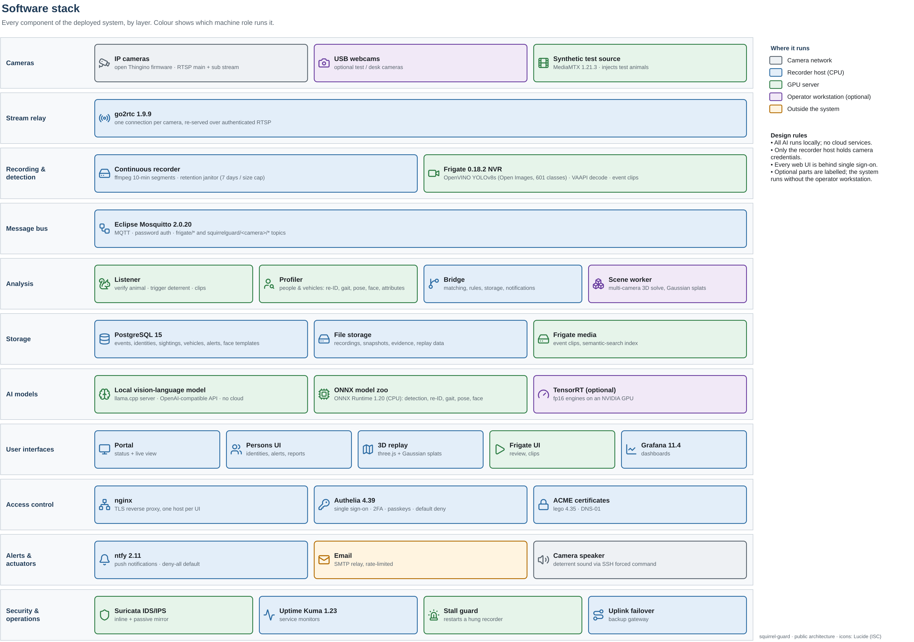
<figcaption>Figure 1. Software stack by layer. Colour shows the machine role that runs each component.</figcaption>
</figure>

<figure class="wide">
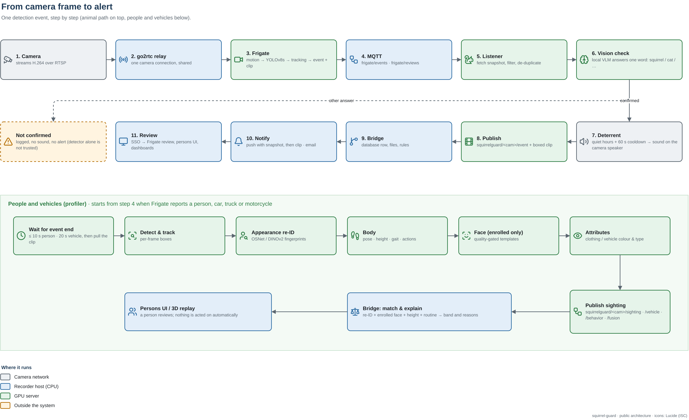
<figcaption>Figure 2. One event from camera frame to alert. Animals take the top path; people and vehicles go through the profiler lane.</figcaption>
</figure>

---

## 4. Detection and deterrence 

The original job: notice a squirrel, make sure it is one, and make a noise. A detector finds the animal, a second model must agree, and only then does the camera's speaker sound. People are told by notification; nothing is ever done to them automatically.

### 4.1 Animal detection 

| | |
|---|---|
| **Status** | <span class="st st-prod">Production</span> |
| **Runs on** | GPU server (Intel integrated GPU through OpenVINO) |
| **Model** | YOLOv8s trained on Open Images V7 (601 classes, "Squirrel" is one of them), ONNX |

Frigate decodes the stream, runs motion detection and then the object detector on moving regions, tracks each
object and opens an event. Score filters in the reference configuration: squirrel minimum 0.35 per frame and
0.55 for the tracked object; person 0.35 and 0.5.

<figure>
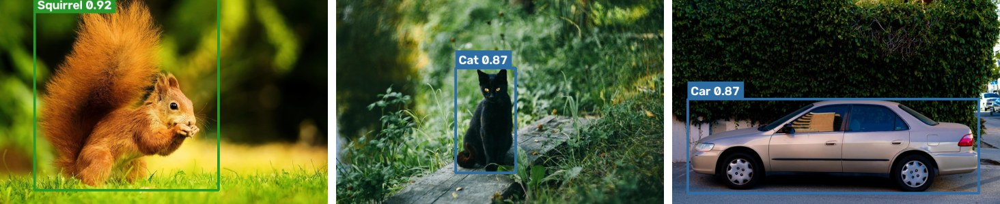
<figcaption>Figure 3. The shipped detector on three stock photos (credits in Appendix B). The cat is not called a squirrel.</figcaption>
</figure>

**Measured**

- 13 stock photos at 640×360: 8 of 8 squirrels found (scores 0.60–0.96), 0 of 4 cats called squirrel, about 90 ms per frame on a CPU.
- In the NVR on the integrated GPU: about 43 ms per inference at 640×640.

**Limits**

- The stock photos are close-ups. Real garden squirrels are smaller in the frame; the figures above must be re-measured on the installation's own camera.

### 4.2 Second-opinion check by a vision-language model 

| | |
|---|---|
| **Status** | <span class="st st-prod">Production</span> |
| **Runs on** | GPU server (local model, no cloud) |
| **Model** | Open-weight Qwen-family vision-language model served by llama.cpp |

Before anything happens, the detection crop (longest side 384 px) is sent to a local vision-language model, which
must answer with one word from a fixed list: squirrel, cat, dog, bird, rabbit, raccoon, person, other, nothing.
The deterrent fires only when the answer matches the detector. If the model is unreachable, the default is to
**do nothing** (`trust_detector_if_down = false`).

**Measured:** the verifier agreed with the label on 13 of 13 stock photos; about 1.3 s per check on the GPU
server (15–20 s on a laptop that keeps model experts in system RAM).

**Limits:** the model server has one shared slot, so checks can queue behind other work (timeout 60 s).

### 4.3 Deterrent 

| | |
|---|---|
| **Status** | <span class="st st-prod">Production</span> (the software ships in dry-run mode by default) |
| **Runs on** | Recorder host sends the command; the camera plays the sound |

A confirmed squirrel triggers one of four audible sounds on the camera's own speaker (frequency sweeps, a screech
and a clatter, 1.5–8 kHz; "random" by default), at most once per 60 s and never during quiet hours (21:30–07:00
in the reference configuration). The command travels over SSH with a dedicated key that the camera accepts for a
single script only; the script refuses anything but a known sound name or "random".

**Measured:** the screech at volume 50 raised the camera microphone level by about 7 dB.

**Limits and cautions**

- The sounds are audible to people and pets. Camera speakers cannot produce ultrasound.
- Evidence for acoustic deterrents is weak and animals habituate; varying the sound slows this.
- An optional spoken notice ("Person detected. Video surveillance is recording.") exists and is **off** in the reference configuration.

### 4.4 Notifications and evidence clips 

| | |
|---|---|
| **Status** | <span class="st st-prod">Production</span> |

Confirmed animal events go to a `squirrels` push topic (at most one per 2 minutes); person events go to a
`people` topic (at most one per 5 minutes). Each push carries a snapshot with the box, label, score and time. A
second push follows with a short H.264 clip (960 px wide, under 9.5 MB) in which the detector is re-run and boxes
are burned in. Email is optional and rate-limited. Tapping a notification opens the NVR review page behind single
sign-on.

---

## 5. Camera functions 

Everything between the lens and the analysis: getting the video off the cameras once, recording it, knowing where on the ground a pixel is, and finding people who are too small for the main detector.

### 5.1 Stream relay, continuous recording and NVR 

| | |
|---|---|
| **Status** | <span class="st st-prod">Production</span> |

- **One connection per camera.** go2rtc holds the only connection to each camera and re-serves it, so the recorder, the NVR and test tools never contact the camera directly. Only the recorder host has camera credentials.
- **Continuous recording.** Streams are copied without re-encoding into 10-minute segments and deleted after 7 days or when a 350 GB cap is reached.
- **Event clips.** The NVR keeps alert clips for 14 days and detection clips for 7 days, with 5 s before and 10 s after each alert.
- **Health.** A stall guard restarts the NVR when a camera's picture freezes or its frame rate becomes implausible; a status page and uptime monitors show each service and the age of the newest recording.

### 5.2 Calibration: ground position and height 

| | |
|---|---|
| **Status** | <span class="st st-prod">Production</span> |

A printable 9×6 checkerboard (25 mm squares) measures lens distortion. Camera pose comes from a one-minute walk
by a person of known height, or from tape-measured or map points. After calibration, a foot position in the image
becomes a position on the ground and a person's height can be estimated.

**Measured:** lens calibration reduces simulated height error from about 3–4 cm to about 1.6 cm; a good lens fit
has an error below 1 px; the walk method leaves a residual under about 4 cm; a check against a second person of
known height is expected within about 5 cm.

**Limits:** feet must be on the same ground plane as the calibration (steps, slopes and hidden feet give wrong
values); hair, hats and shoes count as height. Height never decides identity.

### 5.3 Small-person sweeper 

| | |
|---|---|
| **Status** | <span class="st st-prod">Production</span> (one camera) |

The NVR detector misses distant walkers: a person about 65 px tall at 40–45 m scored 0.02–0.08 against a 0.35
threshold. Once per second the sweeper takes the latest frame, finds small moving areas, crops a 320 px tile
around each (up to 6) and runs a person detector at 2× zoom (scores 0.53–0.78 on the same walker). A person seen
in two or more sweeps without an NVR event becomes an NVR event, so it is recorded and reviewed like any other.

**Measured:** on a test recording the walker was found at second 9 and tracked for 22 s (scores 0.52–0.87),
producing one event; a people-free clip with a passing car produced none; about 0.36 s of CPU per sweep.

**Limits:** at that distance faces are about 8 px, so no face recognition is possible; re-identification and
attributes are weaker on 65 px people; someone crossing the view in under about 2 s can still be missed.

### 5.4 Image enhancement for human viewing 

| | |
|---|---|
| **Status** | <span class="st st-exp">Experimental</span> (offline, operator workstation) |
| **Methods** | Lucky imaging (no learned model), BasicVSR++ ×4 video super-resolution |

Lucky imaging selects the sharpest frames with a similar pose, aligns them with sub-pixel accuracy, rejects
outliers and averages them, so every output pixel is a weighted average of real camera pixels, with an
uncertainty map. BasicVSR++ is a regression model with no generative prior.

**Safeguards:** outputs are labelled **ENHANCED**, the original is kept beside them, and they are **never used for
face or plate recognition**. Generative face restorers (GFPGAN, CodeFormer and similar) are excluded by policy.

**Measured** (sharpness against the true full-resolution face, best single frame vs. lucky stack): 34 px faces
22.1 → 23.3 dB; 22 px 20.1 → 23.5 dB; 17 px 21.3 → 22.1 dB; at 15 px alignment failed (23.2 → 17.1 dB), which the
quality check flags as "suspect" and falls back to the single frame.

### 5.5 Acceleration 

Models run on CPU by default. On an NVIDIA GPU, optional fp16 TensorRT engines give the same results much faster:

| Model | ONNX Runtime CPU (4 threads) | TensorRT fp16 | Agreement |
|---|---|---|---|
| AdaFace IR-101 (face) | 73.5 ms per face | 0.75 ms per face | cosine ≥ 0.99987 |
| YOLOv8s-pose (pose) | 108.7 ms per frame | 9.7 ms per frame | box IoU ≥ 0.987, keypoints within 0.32 px |

### 5.6 Synthetic test source 

A test container overlays a stock squirrel cut-out on a live stream at 120, 200 and 300 px widths in a 60 s cycle
and feeds it through a private RTSP relay into a disabled test camera. The whole pipeline can be exercised without
animals.

---

## 6. People analysis 

How the system describes a person it has seen and decides whether it has seen them before: by clothing and build, by the way they walk, by their face if they are enrolled, and by what they carry and do. Every result is a ranked suggestion for a human reviewer.

<div class="note">
All people features run locally, are reviewed by a person, and follow the rules in
<a href="#12-privacy-safety-and-governance">section 12</a>. No feature in this section searches any outside
database, and none of them can put a name to a person who has not been enrolled with consent.
</div>

### 6.1 Appearance re-identification 

| | |
|---|---|
| **Status** | <span class="st st-prod">Production</span> |
| **Model** | OSNet x0.25 (MSMT17), 4.6 ms per crop on CPU |

For each visit, six sampled body crops are averaged into one appearance fingerprint (mostly clothing and build).
The bridge compares it with earlier visits and reports a band (strong, likely, possible, unlikely) with an
estimated percent; for example a similarity of 0.70 maps to about 70 %, 0.55 to about 40 %. A match strip shows
the new crop beside the three most similar earlier sightings.

**Measured** (17 sightings of one consenting person on one day against 23 stranger visits from stock clips): AUC
0.91 (95 % CI 0.84–0.99), rank-1 1.00, true-positive rate at zero false positives 0.54. Three alternative models
were evaluated and none was measurably better.

**Limits:** only 57 % of same-person visit pairs reached the 0.70 match level, while the closest stranger already
scored 0.71. Strangers came from stock clips, so real-world figures will be worse. Clothing changes across days,
night infrared and real strangers in the same light are not measured. Appearance alone never names anyone.

### 6.2 Gait signature (learned) 

| | |
|---|---|
| **Status** | <span class="st st-prov">Enabled, provisional</span> (weak evidence only; licence open, see section 14) |
| **Model** | GaitBase (OpenGait, trained on GREW) on YOLOv8s-seg silhouettes |

The person is cut out frame by frame and the silhouette sequence becomes a gait vector. It is used only as a weak
hint that can nudge a band, never to decide identity.

**Measured:** AUC 0.96 (CI 0.92–0.99) on 91 same-person pairs; cost about 0.7 s per 60 silhouettes plus about
30 ms per silhouette frame. In practice the same person's distance sat between the "same" and "different"
thresholds, so the explanation step mostly reports "neutral". A hand-built skeleton gait signature was at chance
(AUC 0.52–0.53) and was not used.

**Limits:** needs about 10 clean silhouettes covering a full stride, walking roughly side-on for 4 or more steps;
home-camera silhouettes are noisy.

### 6.3 Pose, skeleton rig and 3D body 

| | |
|---|---|
| **Status** | <span class="st st-prov">Enabled, provisional</span> (calibrated cameras only) |
| **Models** | YOLOv8s-pose (17 keypoints); RTMW whole-body (133 keypoints); inverse-kinematics rig; SMPL neutral body |

A consistent skeleton is fitted to each visit, with fixed bone lengths and anatomical joint limits, from one or
more calibrated cameras. It gives stature, joint angles and a walking path, and drives the 3D replay.

**Measured:** in a held-out camera the rig's error was 0.029 box heights (22 px) against 1.06 box heights (743 px)
for the previous method; single-camera stature 1.68 m vs 1.70 m from two cameras; a synthetic walker's stature
1.767 m vs 1.78 m true, 1.5 cm median joint error. About one CPU-minute per 20 s event, in the background.

**Limits:** gait from the rig needs at least three alternating heel strikes and is not yet validated on real data;
world scale rests on assumed room dimensions until a tape measurement is taken; night infrared not measured.

### 6.4 Face identification of enrolled people 

| | |
|---|---|
| **Status** | <span class="st st-prov">Enabled, provisional</span> |
| **Models** | InspireFace (detection, alignment, quality, liveness, pose); AdaFace IR-101 (face embedding) |

From the best faces of a visit (weighted by quality, size, pose and sharpness, with outlier rejection) one face
template is built. It is compared **only** with the templates of people the operator has enrolled with consent.

**Gates before any match:** faces of at least 32 px; at least 3 faces; minimum quality and consistency; passive
liveness must pass before a template can mark someone as household.

**Measured**

- Public face set (CelebA, 24 px colour faces), true-accept rate at 0.1 % false-accept: 0.784 with the first model, **0.950** (CI 0.94–0.96) with AdaFace IR-101.
- Own camera, leave-one-visit-out: the margin between the lowest same-person score and the highest stranger score grew from 0.077 to **0.280**. This is a wider margin, not a measured accuracy gain: the camera data is one person on one afternoon.
- Faces under about 32 px are unusable and fail liveness (liveness 0.78–0.98 on real faces of 32 px or more, 0.04 at 25 px or less).
- Cost: 46–88 ms per face for the embedding.

**Limits:** zero confirmed real strangers in the camera test set; liveness has not been tested against spoof
attacks; night infrared too thin to conclude. Thresholds are provisional, and the project notes recommend a
shadow-mode period and recalibration with real strangers.

### 6.5 Unnamed tracking of repeat visitors 

| | |
|---|---|
| **Status** | <span class="st st-prov">Enabled, provisional</span> (can be switched off with one setting) |

Usable faces of people who are not enrolled are grouped into **unnamed** identities ("Unknown #n"), so a repeat
visitor can be recognised as the same unknown person over time. It **never names anyone and never makes anyone
trusted**; only the operator can label or enrol. Order of evidence: enrolled face, then the NVR's own face name,
then an unnamed face track, then body appearance.

**Measured:** threshold 0.40 gave zero false merges on 315 public-set identities (highest impostor 0.323) and on
stock strangers; 82 % of the same person's pairs passed. Unknown people and their face data are deleted after
90 days.

### 6.6 Small-face pipeline 

| | |
|---|---|
| **Status** | <span class="st st-exp">Experimental</span> (offline, not in the live pipeline) |

Finds the head from body keypoints, warps a standard face crop directly from camera pixels and combines many
frames with quality weights. Faces under the minimum size are logged as "too far" and never used.

**Measured** (one person, faces shrunk to simulate distance; 5 stock strangers): combined score 0.89 at 30–33 px,
0.87 at 22–23 px, 0.76 at 16–17 px, 0.03 at 11–12 px; refused below 12 px. Highest stranger score 0.25. Recognition
breaks down between 12 and 16 px. Real distance adds lens blur and compression, so these are best-case figures.

### 6.7 Face shape evidence (explanatory only) 

| | |
|---|---|
| **Status** | <span class="st st-prov">Enabled, provisional</span> |
| **Model** | MediaPipe Face Landmarker (Apache-2.0) |

Shows how a visit's face compares with the **same enrolled person's** stored geometry: feature proportions,
symmetry and relative depth, plus a landmark overlay and a small 3D mesh. A consistent 3D face can be fitted
across frames and, with two calibrated cameras, in millimetres.

**It never decides who someone is.** Comparisons across different identities are refused by the interface, and
shapes are never used to search, rank or name anyone.

<figure>
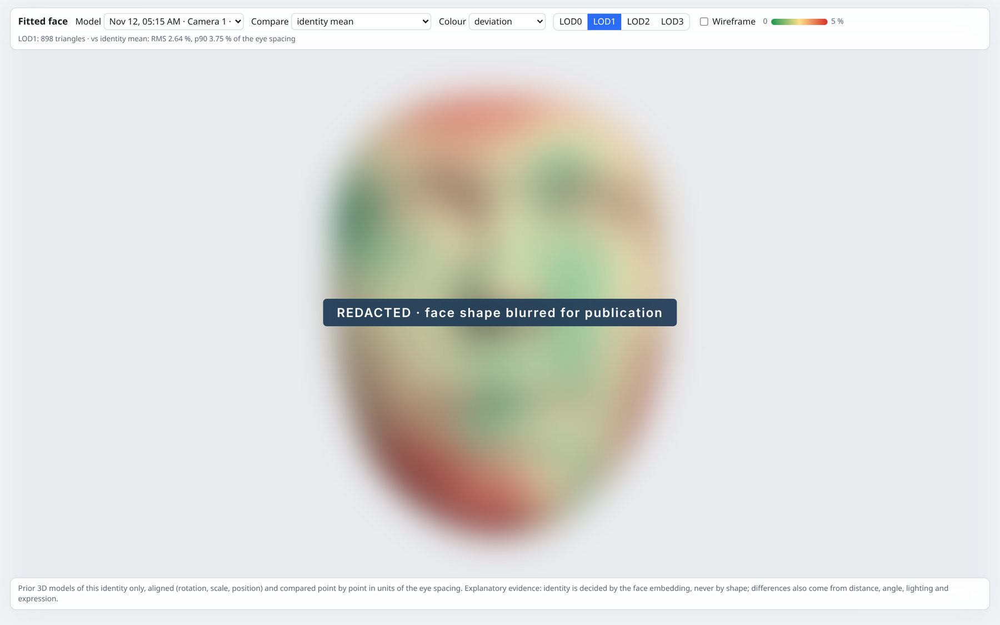
<figcaption>Figure 4. The 3D face viewer, redacted for publication. The mesh is coloured by how far each point deviates from the same person's average shape (0–5 % of the eye spacing); four levels of detail and a wireframe view are available.</figcaption>
</figure>

**Limits:** below about 48 px the mesh is fitted to a handful of pixels; depth is relative shape, not a sensor
measurement; only faces within 25° of frontal are used; evaluation set is very small.

### 6.8 Apparent attributes 

| | |
|---|---|
| **Status** | <span class="st st-prod">Production</span> |
| **Models** | PaddleClas PULC person and vehicle attribute models (about 4–5 ms per crop); local vision-language model for a short description |

Gives 26 apparent person tags (hat, glasses, sleeve length, coat, trousers or shorts or skirt, bags, backpack,
view direction, an age band and a gender estimate) from up to six upright full-body crops per visit.

**Safeguards:** every tag is labelled *apparent*. Age band and gender are a model's guess from a low-resolution
crop, are never used for identity, and can shift a match band by at most a 0.6–1.4 factor, never decide it. **No
race or ethnicity attribute exists anywhere in the system.**

**Limits:** bag tags fire on hands and straps; glasses fire from behind; apparent gender is unstable under
infrared and with hair or close-ups; useless on seated close-ups, so a full-body gate is applied.

### 6.9 Action hints 

| | |
|---|---|
| **Status** | <span class="st st-prov">Enabled, provisional</span> (hint for review, never an alarm on its own) |
| **Model** | ST-GCN++ on 2D skeletons (NTU RGB+D 120 classes), about 90 ms per clip on CPU |

Flags actions such as falling or staggering from the skeleton track. Real falls and staggers scored 0.80–0.95.

**Limits:** the training set is indoor and lab-recorded and has no "walking", "standing" or "lying" class, so the
model always picks something (side-on walking scored "hopping" at about 0.3). Use only as a review hint with a high
threshold or two consecutive windows.

### 6.10 Head direction 

Estimates which way the head faced, frame by frame, from five head keypoints and the calibrated camera. This is
**head** direction, not eye gaze; expect roughly ±20–30°.

### 6.11 Gait measurements and walk profile 

| | |
|---|---|
| **Status** | <span class="st st-new">New, not deployed</span> |
| **Method** | Measurements from the 2D body keypoints already tracked; no gait model, so no model licence |

Where the learned signature in [section 6.2](#62-gait-signature-learned) gives one opaque number, this gives
measurements a person can read and check: how fast someone steps, how regular the steps are, and how the knees
and arms move. Each identity gets a walk profile, the usual value of each measurement and its spread, and a new
walk is compared with it measurement by measurement.

| Measurement | What it is | Camera views |
|---|---|---|
| Cadence | steps per minute | any |
| Step and stride regularity | how alike consecutive steps and strides are | any |
| Left/right symmetry | step regularity against stride regularity; a limp lowers it | any |
| Up-and-down motion | hip travel as a share of leg length | any |
| Step time difference | left-to-right against right-to-left step time | side, diagonal |
| Knee range and knee bend in swing | how far each knee bends through the cycle, in degrees | side, diagonal |
| Arm swing | wrist travel front to back, and the difference between the arms | side, diagonal |
| Step length | in leg lengths; in metres, with speed, when the camera is calibrated | side, diagonal |
| Trunk lean | forward or back | side, diagonal |

Each row of the comparison reads *within the usual range*, *somewhat different* or *different*, and the result
is **consistent**, **partly consistent**, **not consistent**, or **not comparable** when the two walks share
fewer than three measurements (a side view against a walk straight at the camera, for example). The knee angle
through one walking cycle is drawn for each leg over the person's usual range.

<figure class="tall">
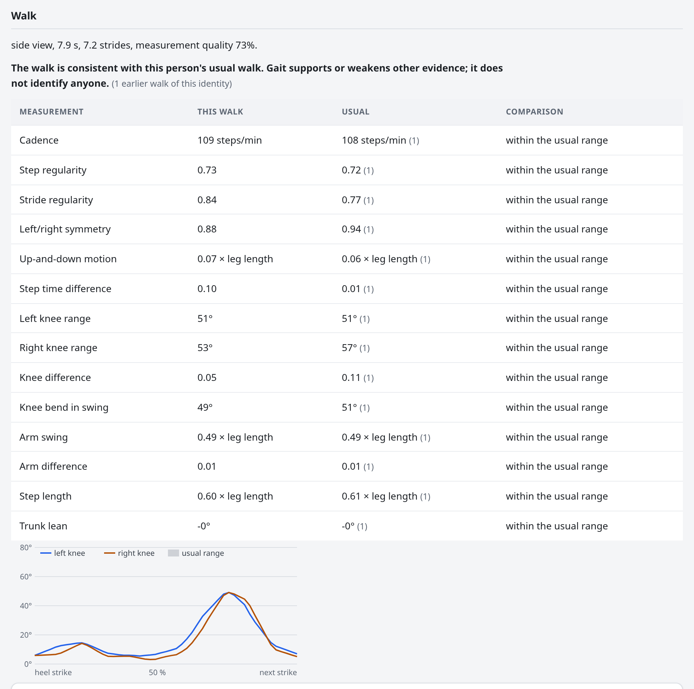
<figcaption>Figure 5. A walk compared with the identity's earlier walks (test data from a synthetic walker). The sentence above the table states what the comparison can and cannot support.</figcaption>
</figure>

**Measured** (synthetic side-view walkers with keypoint noise of 2 to 5 px and 8 to 25 % of frames dropped):
cadence within 4 steps per minute at 10 and at 25 frames per second; knee range within about 10°; a limp, one
knee bending 45 % less, is flagged in the knee measurements; a walk at 140 steps per minute is *not consistent*
with a profile at 110, and a second walk at 112 is *consistent*. A walk straight at the camera yields rhythm only.

**Limits:** **not yet measured on real footage of known people.** The swing-phase knee bend is underestimated at
10 frames per second. People walk differently when carrying something, hurrying, injured or on ice, and two
people can walk alike.

**Safeguards:** the wording is fixed in the interface and in every exported report: gait can support or weaken
other evidence; it does not identify anyone.

---

## 7. Vehicle analysis 

Vehicles are recognised across visits by how they look, by their colour and type, and by the number plate when it can be read. Plates are used only to link repeat visits; nothing is looked up anywhere.

### 7.1 Vehicle re-identification 

| | |
|---|---|
| **Status** | <span class="st st-prod">Production</span> |
| **Model** | DINOv2 ViT-S/14 general image features (no vehicle-specific weights were available) |

One fingerprint per vehicle visit links repeat visits of the same vehicle. Similar models in the same colour can
score close; plate text wins when present.

**Measured** (stock clips, 490 crops, 79 tracks): AUC 0.757, rank-1 0.14, 49 ms per crop. An alternative
(PP-ShiTuV2) scored AUC 0.864 in an offline comparison but is not used. Same-minute footage is easier than the same
car on different days.

### 7.2 Vehicle colour and type 

| | |
|---|---|
| **Status** | <span class="st st-prod">Production</span> (attribute model); <span class="st st-new">New, not deployed</span> (colour measurement) |
| **Model** | PaddleClas PULC vehicle attributes; the new colour reading is a direct measurement, not a model |

The attribute model reports 10 colours and 9 body types, and a class only at 0.5 confidence or more. Its colour
is reliable only in neutral light (a sunset turned a vehicle "red"), and body type is often unsure.

The new colour measurement fixes the two worst cases. Infrared night images have no colour: they are recognised,
and the colour is recorded as *unknown* instead of guessed; the colour words of the other models are dropped for
those visits too. In daylight the colour is balanced against the neutral surfaces around the car (road, walls),
not against the whole frame, so a car that fills the frame keeps its colour and low sun no longer turns a silver
car red.

**Measured:** on 11 stock photos the new measurement gave a sensible colour for 9 (including a black-and-white
photo correctly refused); one copper car read as red with low confidence, and one odd crop read as mixed.

**Limits:** eleven photos are not a validation. Glare and deep shadow are ignored, and dark paint with sky
reflections counts as black.

### 7.3 Licence-plate text 

| | |
|---|---|
| **Status** | <span class="st st-prov">Enabled, provisional</span> (the NVR's reader); <span class="st st-new">New, not deployed</span> (own reader) |
| **Models** |  Frigate's plate reader; own reader: open-image-models plate detector and fast-plate-ocr |

Plate text comes from the NVR's own plate reader, is normalised (A–Z, 0–9) and stored **for matching repeat
visits only**. There are **no outside lookups**. Enhanced images are never passed to a plate reader.

The new reader fills in when the NVR read nothing. Every vehicle crop of a visit is read and the readings are
combined character by character, so a frame that misreads one character is outvoted by the others. The result
keeps a confidence for each character, and the vehicle page shows unsure characters faded and underlined.

**Safeguards:** a reading under 50 % overall confidence, or one the frames do not agree on, is kept as a
*candidate* and is **not** used for matching.

**Limits:** the reader was tried on stock photos only; its accuracy on the installation's camera, at night and at
an angle, is not measured.

### 7.4 Vehicle occupant faces 

| | |
|---|---|
| **Status** | <span class="st st-off">Disabled</span> |

Would look for faces inside a vehicle and compare them only with enrolled people. On the reference camera **0 of
18** vehicle visits produced a usable face (the camera is about 30 cm above the ground and sees bumpers and
wheels). Liveness through a windscreen is untested and expected to fail, which blocks naming by design. Occupants
of non-household vehicles would be deleted after 90 days.

### 7.5 Explained vehicle matching 

| | |
|---|---|
| **Status** | <span class="st st-new">New, not deployed</span> |
| **Method** | A score built from named pieces of evidence; the reasons are stored with each sighting |

A new visit is scored against each known vehicle, and the decision lists its reasons:

| Evidence | Effect on the match |
|---|---|
| Plate | read the same: strong. Differs only in characters that are easily misread (0/O, 8/B, 5/S) or that the reader was unsure of: strong to moderate. Clearly different: decides **different**, however alike the cars look |
| Appearance | from "looks very similar" to "looks different" (DINOv2 similarity, [section 7.1](#71-vehicle-re-identification)) |
| Colour | same, similar (lighting can shift grey to white, red to orange) or different; **not compared at night** |
| Body type | same or different |

The result is a band (strong, likely, possible, unlikely) and a decision: file under the known vehicle, keep
separate but flag as possibly the same, or new vehicle.

**Safeguards:** two look-alike cars with clearly different plates are never merged, which the earlier
appearance-first rule could do.

**Limits:** the bands are this system's own scale. **No labelled vehicle data has calibrated them yet.** Make and
model come only from the vision-language model's description; no openly licensed make-and-model classifier was
found.

---

## 8. Scene understanding 

Beyond who and what: which objects are carried, where a visitor walked and how unusual that was, what two cameras saw together, and a 3D view of the scene for review.

### 8.1 Open-vocabulary objects 

| | |
|---|---|
| **Status** | <span class="st st-prov">Enabled, provisional</span>; the "watched object" alert is **off** by default |
| **Model** | YOLO-World v2 small, about 82 ms per frame on 4 CPU threads |

Names objects in words on person-event frames and says whether each is *carried* (a wrist is inside its box),
*near*, or part of the *scene*; a label must appear on at least two frames. An optional alert can fire when an
unknown or watch-listed person carries a listed object.

**Measured:** a hiker's backpack was found on 80 of 85 frames (score 0.67). False hits: a chair labelled "ladder"
(0.29–0.44, never "carried") and one false "carrying ladder" (0.42) on a hand-held shot.

**Limits:** recall for thin tools (crowbar, bolt cutters, knife) has not been measured on the installation's
camera; thin tools score low (0.15–0.35). The alert should stay off until staged tests have been run.

### 8.2 Path, speed and routine scoring 

| | |
|---|---|
| **Status** | <span class="st st-prod">Production</span> |

Foot positions become a smoothed ground path with uncertainty, speeds, stops, entry and exit direction and time
per zone. From the last 90 days, the bridge learns what is usual for each camera (hour of day, route, stay
length, path shape) and marks a visit **unusual** only when there is enough history, the total surprise exceeds a
self-calibrated threshold (about 1 in 50 ordinary visits) and at least one part is clearly unusual. Each part gets
a plain-language sentence. Routine scores never change an identity, an alert or a decision.

**Limits:** assumes flat ground; any calibration error becomes a systematic position error not reflected in the
uncertainty.

### 8.3 Multi-camera fusion 

| | |
|---|---|
| **Status** | <span class="st st-prov">Enabled, provisional</span> |

When two calibrated cameras see the same event, their clocks are aligned from the motion itself, each view is
checked, and one skeleton is fitted across all views. A disagreeing or moved camera is dropped; a failure leaves
the per-camera results.

**Measured:** one camera alone fits its own view at 0.013–0.016 box heights but is 0.14–0.27 off in the other
view; the fused fit explains both at 0.027–0.040. About 44 s for a 10.4 s window from two cameras.

### 8.4 3D scene of each visit 

| | |
|---|---|
| **Status** | <span class="st st-prov">Enabled, provisional</span> (needs the optional operator workstation) |

For each replay, a worker on the operator workstation takes recorded frames from every calibrated camera, solves
camera poses, trains a Gaussian-splat scene and adds named 3D objects, so the replay shows the space as it was
during the visit. If a camera has moved, no scene is attached and a notice is sent. Scenes follow the sighting's
retention (90 days).

**Measured:** held-out image quality 18.7 dB with a classic pose solver, 24.5 dB with the learned solver and
28.6 dB after refinement.

### 8.5 Site model and camera planner 

Builds a local 3D site model from public data (national lidar, aerial photography, open street footprints) and
estimates where a 1.7 m person can be seen and how tall they will appear: roughly 80 px or more is reliable,
40–80 px marginal, under 40 px usually missed. Useful for deciding camera placement before installation.

---

## 9. Review interfaces 

Where people look at what the system found: a 3D replay of each visit, one panel that holds everything known about it, a visitor log with the reasons for every match, and a dashboard. Every score on these pages is labelled as an estimate.

<div class="note">
<b>About the screenshots.</b> The 3D replay figures use a public stock video (a walker in fog), so nothing is hidden.
All other screenshots come from the reference installation and were redacted in the page before capture: every
image of a person, face or room is blurred; the household member's name is replaced by "Person A"; camera names
are replaced by "Camera 1/2"; heights, third parties' clothing and visit times, and face-shape measurements are
blurred. Scores, bands and layout are unchanged.
</div>

| Interface | Purpose |
|---|---|
|  **3D replay and single pane of glass** | Stick figure, body, video cut-outs, camera view and scene in 3D; one panel with overview, face, related visits, clips, timeline and body and gait. All percentages are labelled estimates for ranking only. |
|  **Persons UI** | Private visitor log: identities and sightings; rename, mark household, known or watch, merge, delete. A "Why?" page per visit shows the evidence. Enrolment requires a consent tick-box. |
|  **NVR review** | Event clips and timeline (Frigate) |
|  **Dashboards** | Grafana panels: events per day, hour of day, deterrent fired, how often the verifier agreed |
|  **Portal** | Service status and a recent still from each camera |

### 9.1 3D replay 

Each visit can be replayed in 3D: the estimated path (blue to red over time) with its uncertainty, footprints, a
2.5 s prediction cone, the head direction, the fitted body, video cut-outs standing on the path, and the camera's
own view projected onto the ground. The legend explains every mark in plain words.

<figure>
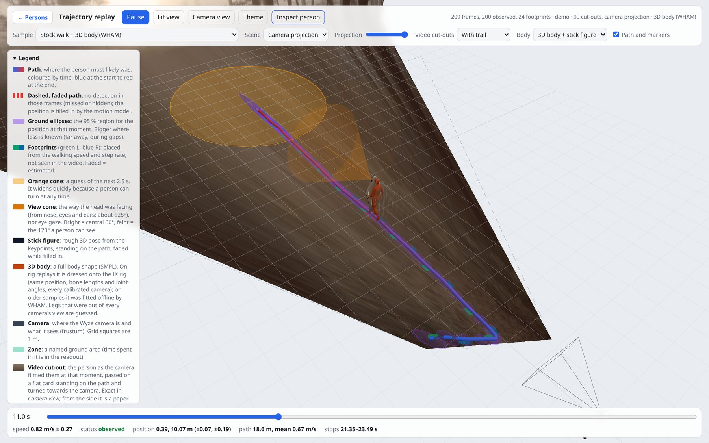
<figcaption>Figure 6. 3D replay of a stock video sample: path, footprints, fitted body and the camera image projected onto the ground.</figcaption>
</figure>

<figure>
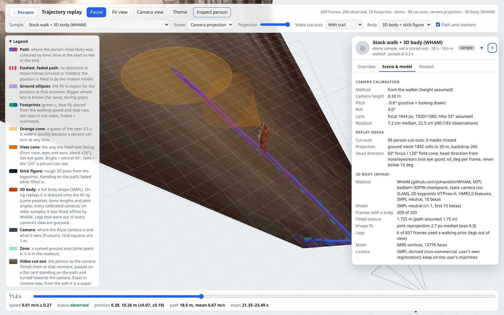
<figcaption>Figure 7. The single pane of glass on a demo sample: recording source, duration, distance walked, stops, heading, step rate and head direction.</figcaption>
</figure>

### 9.2 Single pane of glass 

Clicking the person in a replay opens one panel with everything known about that visit. Tabs: **Overview** (band,
reasons, what they did, apparent look, routine score, movement), **Face** (crops, the face decision against its
threshold, liveness, quality, the fitted 3D face), **Related** (a graph of earlier visits, the identity and vehicles
nearby in time; closer and thicker means stronger), **Clips**, **Timeline** and **Body and gait**.

<figure>
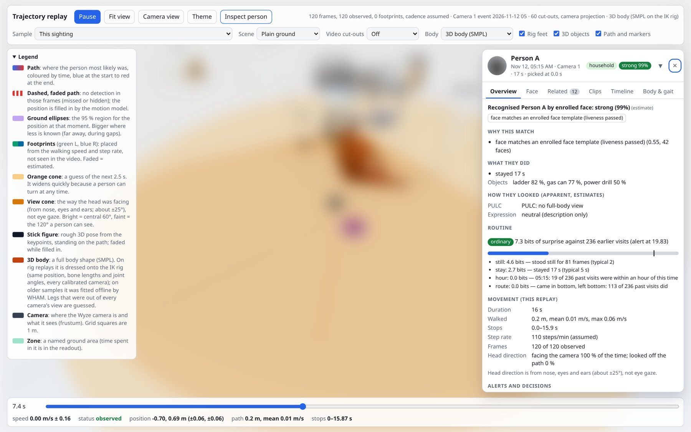
<figcaption>Figure 8. Overview: the match band and its reasons, objects seen, apparent attributes labelled as estimates, the routine score against 236 earlier visits, and movement figures.</figcaption>
</figure>

<figure>
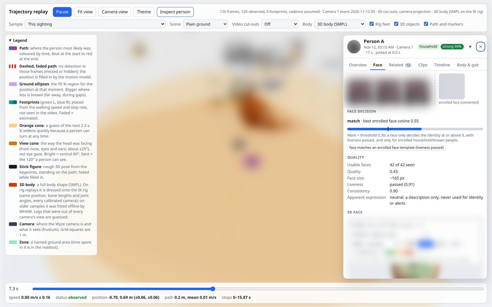
<figcaption>Figure 9. Face: the decision is shown against its threshold, with liveness and quality; a face decides identity only with liveness passed and only for enrolled people.</figcaption>
</figure>

<figure>
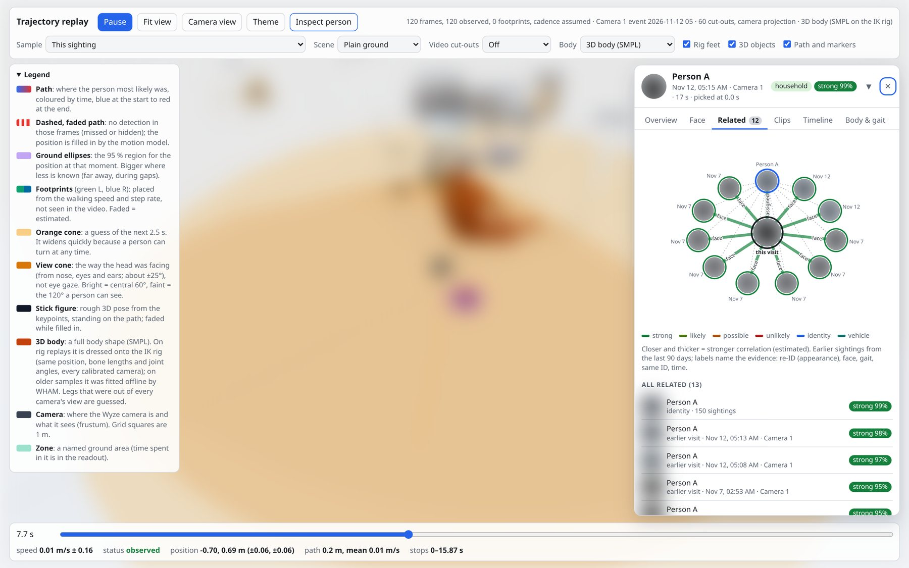
<figcaption>Figure 10. Related: earlier sightings within 90 days, ranked by the evidence named on each link (appearance, face, gait, same identity, time).</figcaption>
</figure>

<figure>
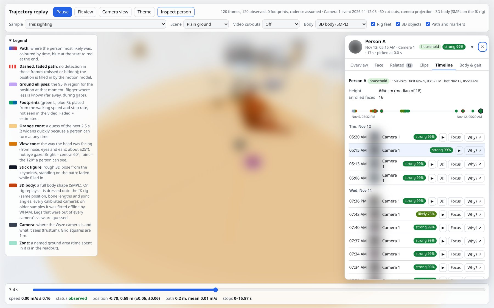
<figcaption>Figure 11. Timeline: every visit of the identity, with its match band and one-click access to the clip, the 3D replay and the evidence page.</figcaption>
</figure>

### 9.3 Persons UI 

The visitor log shares one design system with the 3D replay: the same colours, light and dark themes and theme
setting, a header with the current section highlighted, a search box (press <kbd>/</kbd>), and visible keyboard focus.
Every action gives feedback:

- a short confirmation after each save, merge, delete or face enrolment;
- a confirmation dialog that states exactly what an irreversible action will do, with Cancel selected by default;
- a merge target that must be chosen explicitly (nothing is pre-selected);
- a spinner on the button while a change is being saved, and no double submissions;
- a placeholder for a missing image, click-to-enlarge for pictures, and an explicit "nothing here yet" for empty lists.

On a phone, tables turn into labelled cards.

<figure>
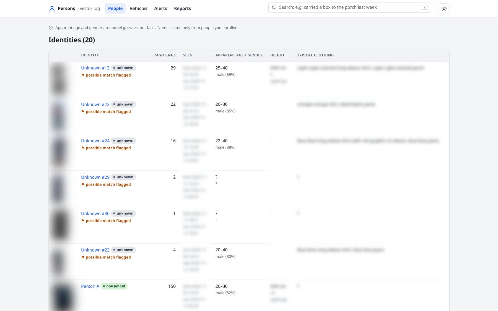
<figcaption>Figure 12. Identity list. Unknown people stay numbered; only enrolled people have names. Age and gender are labelled as model guesses.</figcaption>
</figure>

<figure>
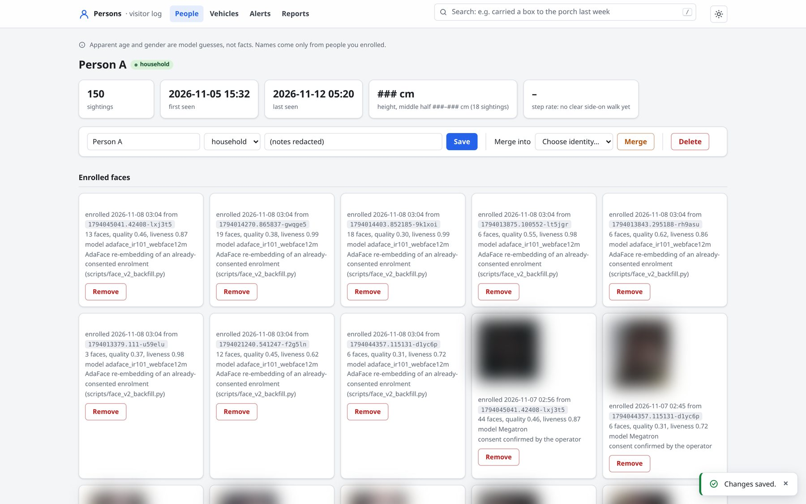
<figcaption>Figure 13. An identity: key facts as cards, all actions in one bar (primary, warning and destructive styles), enrolled faces with their consent record, and the confirmation shown after saving.</figcaption>
</figure>

<figure>
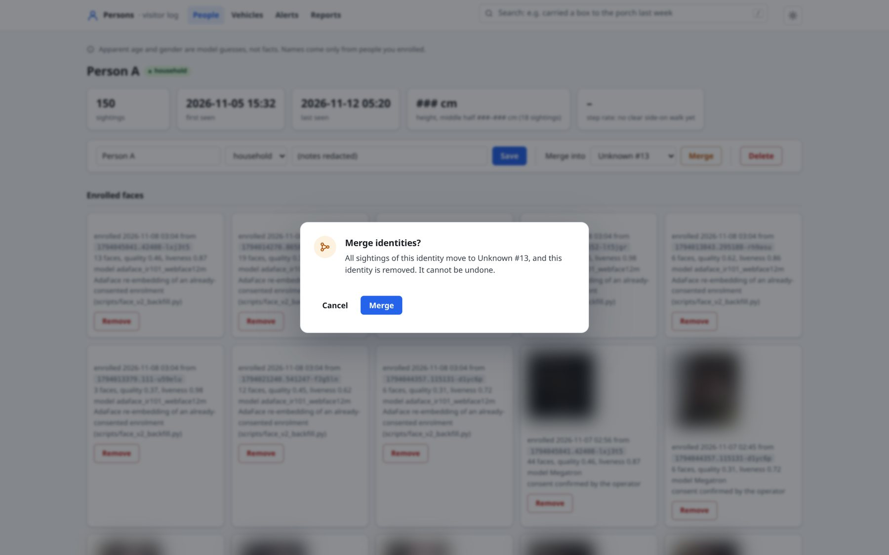
<figcaption>Figure 14. Irreversible actions ask first and name their exact effect.</figcaption>
</figure>

<figure>
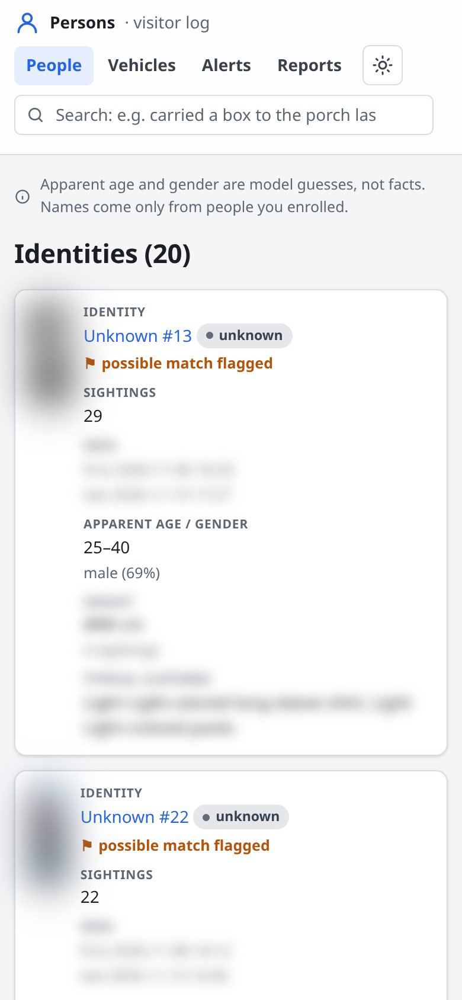
<figcaption>Figure 15. Phone layout: each row becomes a labelled card.</figcaption>
</figure>

<figure>
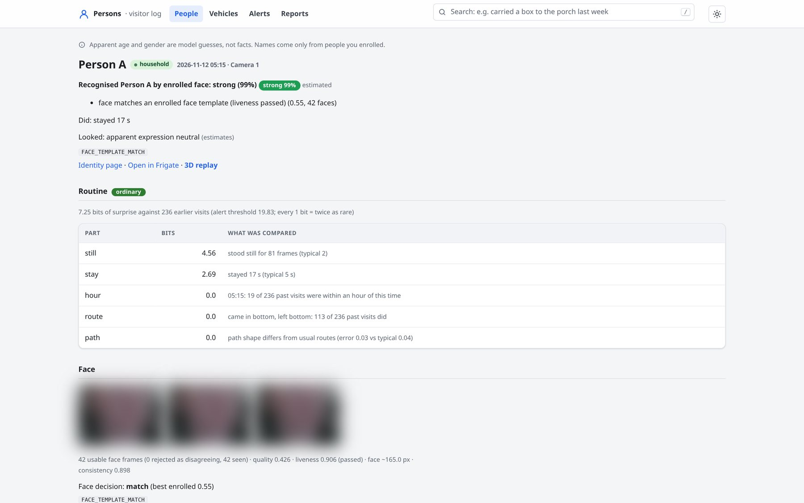
<figcaption>Figure 16. The "Why?" page: the decision in one sentence, its reason code, the routine comparison part by part, and the face evidence.</figcaption>
</figure>

<figure>
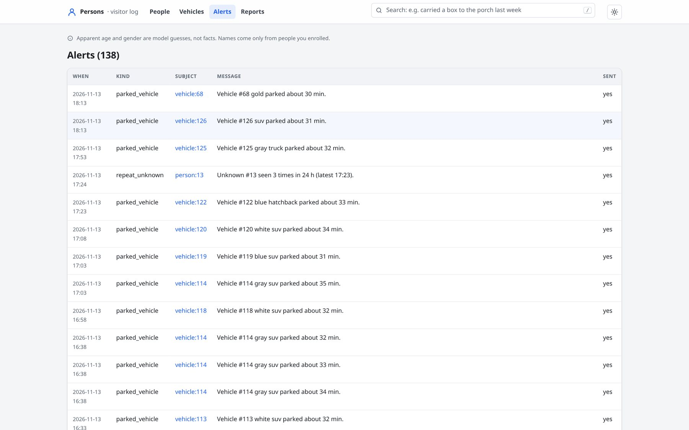
<figcaption>Figure 17. Alerts: only unknown or watch-listed subjects and long-parked vehicles raise alerts; household members never do.</figcaption>
</figure>

### 9.4 Dashboard 

<figure>
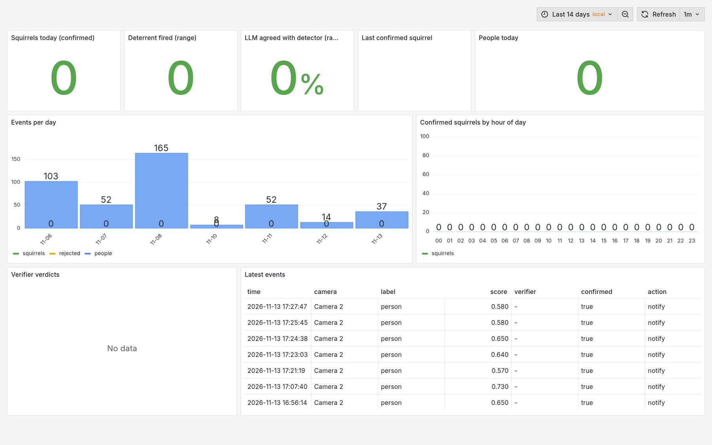
<figcaption>Figure 18. Operations dashboard. The period shown had no confirmed squirrels, so the deterrent never fired; person events are listed with their scores.</figcaption>
</figure>

Every decision about a person is recorded with a band, an estimated percent, stable reason codes (for example
`FACE_TEMPLATE_MATCH`, `PULC_CONSISTENT`, `CARRYING_<LABEL>`), one plain sentence, the inputs and the model
versions. Written reports use facts from the database only.

---

## 10. Evidence handling 

A recording is useful as evidence only if someone else can check where it came from, that it has not changed, and
who handled it. This chapter describes what the review interface records and exports so that a clip, and the
system's analysis of it, can be checked later by a third party without this software.

> **Notice.** Everything in this chapter is <span class="st st-new">New, not deployed</span>: it is in the
> repository with automated tests, and the figures shown come from test data with invented names. It is a
> technical record, not legal advice. Whether it meets a court's or an agency's evidence rules is for their
> counsel and evidence custodian to decide.

| | Safeguard | What a reviewer can check afterwards | Section |
|---|---|---|---|
|  | Roles | who was allowed to view, change and export | [10.1](#101-roles) |
|  | Audit log | who looked at what, and what they searched for | [10.2](#102-audit-log) |
|  | Human review | that a named person confirmed or rejected each match | [10.3](#103-human-review-of-a-match) |
|  | Evidence package | that every file is the one that was exported | [10.4](#104-evidence-packages) |
|  | Outside timestamp | when the package existed, without trusting this system's clock | [10.5](#105-outside-timestamps-and-clocks) |
|  | Capture-time seal | that the continuous recording is unchanged since minutes after capture | [10.6](#106-capture-time-seals) |
|  | Release copy | a copy for wider release with faces and plates blurred | [10.7](#107-release-copies) |
|  | Custody chain | that no log entry was edited, removed or reordered | [10.8](#108-custody-and-audit-chains) |

### 10.1 Roles 

| | |
|---|---|
| **Status** | <span class="st st-new">New, not deployed</span> |
| **Needs** |  single sign-on groups (Authelia);  nginx passes them on |

Three roles, each including the one before it. The role comes from the signed-in account's groups; an account in
none of the groups is refused, and every change to data needs at least the investigator role.

| Role | May |
|---|---|
| **Viewer** | read every page and search |
| **Investigator** | also edit identities and vehicles, record reviews, export evidence, and see and download **their own** exports |
| **Supervisor** | also see every export, the custody log and the audit log |

New accounts for these roles can sign in to the review site only, with a password and a second factor. The page
header always shows who is signed in and in which role.

### 10.2 Audit log 

| | |
|---|---|
| **Status** | <span class="st st-new">New, not deployed</span> |
| **Stored** |  PostgreSQL table that refuses changes; entries are hash-chained |

Every page and every data request that passes sign-in is written down: time (UTC), account, role, what was done
(a view, a change, a review, a refusal), the page address with its query, and the source address. Searches are
therefore recorded with the words that were searched for. Refused requests are logged too. Supervisors can filter
the log by person and by kind, and download all of it as <span class="tag tag-file">JSON</span>.

**Limits:** the log records the signed-in account, not who sat at the keyboard. Pictures, scripts and styles are
not logged one by one; the page that shows them is.

### 10.3 Human review of a match 

| | |
|---|---|
| **Status** | <span class="st st-new">New, not deployed</span> |

Every sighting page starts with its review state. Until a person decides, it reads **NOT CONFIRMED BY A PERSON**
in red. An investigator records *confirmed*, *rejected* or *unsure*; rejecting requires a note on what was
compared. Reviews are never edited: a new one replaces the decision, and the history stays. Exports carry the
latest review and the full history for every item, and the printed report shows unreviewed items in large red
type.

<figure>
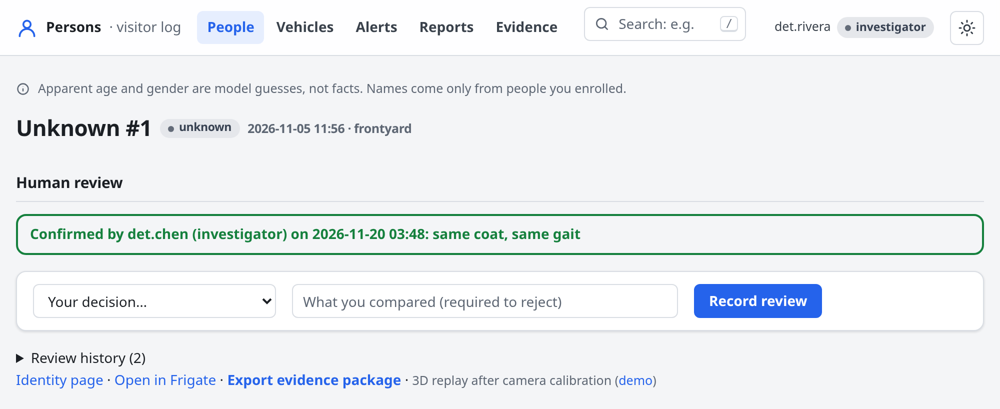
<figcaption>Figure 19. Human review at the top of a sighting (test data, invented names). The decision, the reviewer, the time and the note are shown; earlier decisions stay in the history.</figcaption>
</figure>

**Safeguards:** a match is the system's suggestion until a named person has reviewed it, and the report says which
of the two it is. A confirmed review is a person's judgement, recorded; it is not proof that the match is right.

### 10.4 Evidence packages 

| | |
|---|---|
| **Status** | <span class="st st-new">New, not deployed</span> |
| **Format** | <span class="tag tag-file">ZIP</span> with a manifest, up to 25 sightings for one case |
| **Verify with** |  Python 3,  OpenSSL, `sha256sum`: no squirrel-guard software |

From a sighting (one item) or an identity (its sightings), an investigator chooses **Export evidence package**,
ticks the items, gives a case reference and a purpose, and confirms that they are authorised. The package is
built in the background and gets its own page.

<figure>
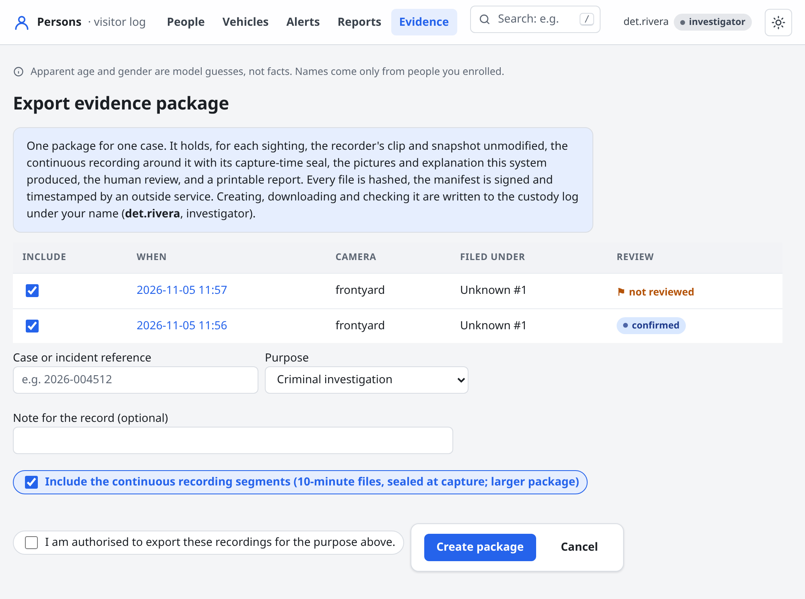
<figcaption>Figure 20. The export form (test data). An unreviewed item is flagged before it is exported, and the investigator must tick that they are authorised.</figcaption>
</figure>

```tree
# title: What a package contains
items/01/original/clip.mp4, snapshot.jpg    the event recorder's files as retrieved, unmodified
items/01/original/segments/*.mkv            the continuous recording around the event (optional)
items/01/derived/                           crop, evidence card, match strip, track
items/01/record/visit.json                  the explained match and the walk comparison
items/01/record/review.json                 the review decision and its history
items/01/record/ledger.jsonl, anchors.jsonl capture-time seals of the included segments
report.html                                 printable report
manifest.json                               every file with SHA-256, size, role and origin; who, when, why; clocks
manifest.sig, signing-key.pem               Ed25519 signature of the manifest, and the public key
manifest.tsr                                RFC 3161 timestamp of the manifest from an outside service
SHA256SUMS, verify.py, README.txt           for checking the package by hand
```

Nothing is hidden: an event clip the recorder no longer had, a segment removed by retention, or a timestamp
service that did not answer is written into the package, its report and its page.

```console
# title: Checking a package without this software
$ unzip EX-20261119-00012.zip -d pkg && cd pkg
$ sha256sum -c SHA256SUMS
$ python3 verify.py   # files, extra files, ledger chain, segment seals, signature
$ openssl pkeyutl -verify -pubin -inkey signing-key.pem -rawin -in manifest.json -sigfile manifest.sig
$ openssl ts -verify -data manifest.json -in manifest.tsr -CAfile /etc/ssl/certs/ca-certificates.crt
```

The key fingerprint printed in the package should be compared with the one the operator publishes. The signing
key is created at the first export and kept on the recorder host; replacing it would cut older packages off from
the installation that made them.

<figure class="tall">
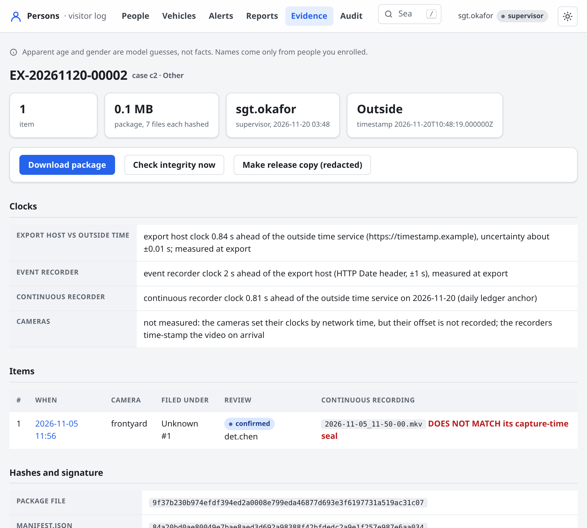
<figcaption>Figure 21. A package page (test data). In this test a recording segment was changed after it was sealed, and the page says so in red: "DOES NOT MATCH its capture-time seal".</figcaption>
</figure>

**Measured:** the automated tests build packages from test data and check them with the bundled `verify.py` and
with OpenSSL. They confirm that a changed file, an extra file, a changed ledger entry and a changed recording
segment are each reported, and that a package is still made, and says so, when the timestamp service does not
answer. No package has yet been made from the reference deployment's recordings.

### 10.5 Outside timestamps and clocks 

| | |
|---|---|
| **Status** | <span class="st st-new">New, not deployed</span> |
| **Method** | RFC 3161 timestamp from an outside authority; only a SHA-256 hash is sent |

The SHA-256 of `manifest.json`, and nothing else, is sent to a timestamp authority, which returns a signed token.
The token proves that the manifest existed at that time without trusting this installation's clock or database.
Because every manifest also records the custody log's latest hash, each token anchors the custody log as well.
The service can be changed or switched off; a package made without it says so.

Every export also records, in plain words, how far each clock was off:

| Clock | Compared with | How |
|---|---|---|
| Export host | the outside time service | a separate timestamp request, with its uncertainty |
| Event recorder | the export host | the HTTP `Date` header, to about one second |
| Continuous recorder | the outside time service | the most recent daily anchor of the recording ledger |
| Cameras | not measured | the operator can state how the cameras keep time; the recorders stamp video on arrival |

**Limits:** camera clocks are not measured. The time shown inside a picture by the camera is not evidence of the
time of recording; the recorder's time is.

### 10.6 Capture-time seals 

| | |
|---|---|
| **Status** | <span class="st st-new">New, not deployed</span> |
| **Runs on** | Recorder host (a small sealing service beside the recorder) |

The continuous recording is written in 10-minute segments. A few minutes after a segment is closed, the sealer
adds its SHA-256 to a hash chain for that camera, and once a day it has the head of the chain timestamped by the
outside service. At export, each segment around the event is hashed again and compared:

| The package says | Meaning |
|---|---|
| matches its capture-time seal | unchanged since it was sealed |
| **DOES NOT MATCH** its capture-time seal | changed after sealing; shown in red |
| not sealed yet | still being recorded, or the sealer was not running |
| removed by retention | the hash is in the ledger, the file is gone |

A broken ledger is never rewritten: the sealer stops sealing that camera and reports it every minute.

**Limits:** a seal says nothing about the minutes between capture and sealing, or about whether the camera showed
the scene faithfully.

### 10.7 Release copies 

| | |
|---|---|
| **Status** | <span class="st st-new">New, not deployed</span> |
| **Models** |  YuNet face detector; open-image-models plate detector |

**Make release copy** on a package page writes a second, signed <span class="tag tag-file">ZIP</span> in which
every face and number plate the detectors find is blurred. It covers the event clip and the stills, not the
continuous segments, and has no sound. Its manifest names the hash of the package it came from, and each redacted
file names the hash of its original.

**Limits:** detectors miss things, such as small or turned-away faces and plates at steep angles. A person must
check every frame before release; the copy's own README says so.

### 10.8 Custody and audit chains 

| | |
|---|---|
| **Status** | <span class="st st-new">New, not deployed</span> |
| **Method** | each entry's hash covers the entry before it (SHA-256) |

The custody log (package created, downloaded, checked, released) and the audit log are both hash chains: the hash
of an entry is computed over the previous entry's hash and the entry's own content. The tables refuse changes,
deletions and truncation. An edit that bypasses that protection shows as a broken chain on the page, and the
downloads include the rule, so anyone can check the chain again on their own.

<figure>
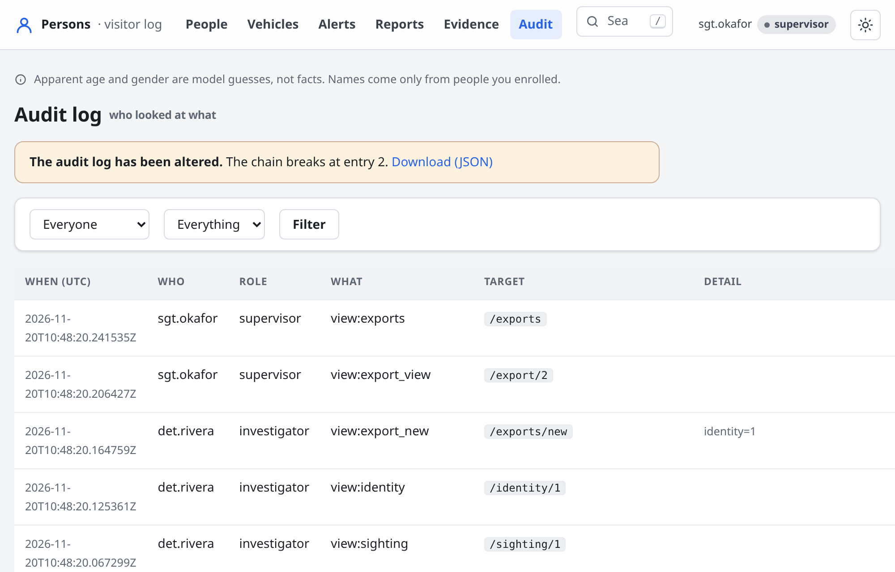
<figcaption>Figure 22. The audit log after a test edited one entry behind the software's back. The page reports the break and the entry where the chain stops matching.</figcaption>
</figure>

**Measured:** the tests edit, remove and reorder log entries and confirm that each change is detected.

### 10.9 What this does not prove 

- **That the camera showed the scene faithfully,** or anything about the minutes between capture and sealing.
- **Who sat at the keyboard.** The logs record the signed-in account.
- **That a match is right.** A confirmed review is one person's judgement, recorded with their name.
- **That it is admissible.** That is a legal question for the court or agency concerned.

---

## 11. Installation and operation 

One console, `sg`, installs, configures and runs every machine role. It has three front ends that do the same
things: commands for scripts, a full-screen menu for a terminal, and a web page for a browser on the same
machine.

### 11.1 The console 

| | |
|---|---|
| **Status** | <span class="st st-new">New, not deployed</span> (the reference deployment was installed by hand) |
| **Needs** |  Python 3.11 or newer, nothing else: it runs before any package is installed |
| **Front ends** | <span class="tag">CLI</span> <span class="tag">TUI</span> <span class="tag">WEB</span> |

| Front end | Start it with | Made for |
|---|---|---|
| <span class="tag">CLI</span> Commands | `./sg status`, `./sg check`, `./sg setup`, … | scripts, slow connections, copy and paste from this guide |
| <span class="tag">TUI</span> Terminal menu | `./sg` | a terminal or an SSH session, keyboard only |
| <span class="tag">WEB</span> Web console | `./sg gui` | a browser on the same machine, or through an SSH tunnel |

<figure class="tall">
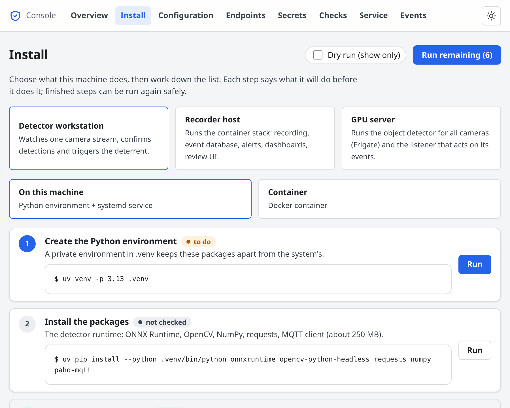
<figcaption>Figure 23. The web console's Install page on a machine where nothing is installed yet. Each step shows the commands it will run before it runs them.</figcaption>
</figure>

**Measured:** 35 automated tests cover the console and its endpoint tests, using a throwaway copy of the software
and stand-in servers. No test installs on a real machine.

### 11.2 Machine roles and install steps 

| | Role | Install steps the console offers |
|---|---|---|
|  | **Detector workstation:** watches one camera stream, confirms detections, triggers the deterrent | Python environment, packages, configuration, detector model, camera stream address, deterrent sound, background service, start |
|  | **Recorder host:** recording, event database, alerts, dashboards, review interface |  Docker, copy the stack files, database address, generate passwords and load the tables, start the containers |
|  | **GPU server:** the object detector for all cameras and the listener that acts on its events |  Docker, camera list for the NVR (by hand), start the NVR and the listener |

Every step says why it exists and shows its commands first. A dry run prints what each step would do and changes
nothing; finished steps can be run again safely. The console can only run this fixed list: there is no way to
run an arbitrary command through it.

```console
$ ./sg setup --dry-run   # show every step and its commands, change nothing
$ ./sg setup   # the install menu
$ ./sg check   # preflight checks; exit code 1 if any fail
$ ./sg status   # role, install progress, checks, service, last event
```

### 11.3 Running the detector in a container 

| | |
|---|---|
| **Status** | <span class="st st-new">New, not deployed</span> |
| **Needs** |  Docker Engine with the compose plugin |

The detector workstation can run as a container instead of a Python environment with a
 systemd service; `./sg runtime docker` switches, and the
install steps change to match. The container runs with a read-only file system, with all Linux capabilities
dropped, and as the user who started it, so the events it writes belong to that user. Secrets are passed in from
the private environment file at start and are never built into the image.

### 11.4 Configuration and secrets 

Settings live in one  TOML file. The console edits it line by line,
so comments and layout survive, and keeps the previous version beside it. A change is refused, and the file left
untouched, when the value has the wrong type, is out of range, or would leave the file unreadable.

Secrets (the camera stream address with its password, broker passwords, API keys) are kept apart, in a file only
the owner can read. The console can set, replace and remove them. It never shows one again: lists say *set* or
*not set*, checks say "reachable" without naming the host, and log lines have passwords inside addresses masked.

```console
$ ./sg config set camera.fps 5   # checked, then saved; the previous file is kept
$ ./sg env set SG_RTSP_URL   # asks for the value, hidden
$ ./sg env list   # which secrets are set; values are never shown
```

### 11.5 Endpoints 

| | |
|---|---|
| **Status** | <span class="st st-new">New, not deployed</span> |

The Endpoints page lists every server a machine talks to, with its address, a **Test** button and, where it
applies, an API key and a model name.

| Role | Endpoint | Protocol | The test reports |
|---|---|---|---|
| Detector, GPU server |  Second-opinion model: llama.cpp or any OpenAI-compatible server | <span class="tag tag-proto">HTTP</span> | whether it answers or is still loading, which models it has, and whether the loaded model accepts images |
| GPU server |  Description model for people and vehicles | <span class="tag tag-proto">HTTP</span> | the same; it falls back to the second-opinion model when it has no address of its own |
| GPU server |  NVR (Frigate) API | <span class="tag tag-proto">HTTP</span> | the NVR's version, or that the signed-in port was given by mistake |
| Detector, GPU server |  Message broker | <span class="tag tag-proto">MQTT</span> | whether the broker's port answers |
| GPU server | Review link sent in notifications | <span class="tag tag-proto">HTTPS</span> | whether it answers; a sign-in redirect counts as normal |
| Recorder host | Timestamp service for evidence | <span class="tag tag-proto">RFC 3161</span> | one real timestamp of a fixed test value, and how far the service's clock is from this machine's |

A model server started with an API key needs that key here; it goes to the private secrets file and is sent with
each request. The model name matters only for model routers and for servers other than llama.cpp, and a test
fills in the list of names to choose from.

<figure class="tall">
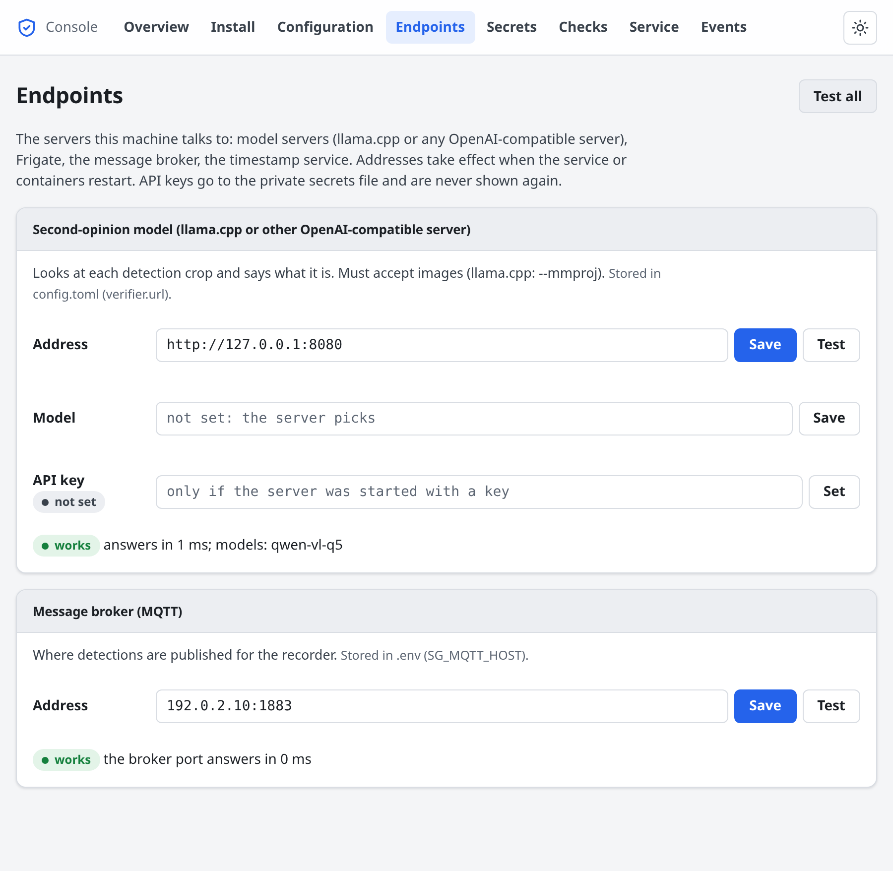
<figcaption>Figure 24. The Endpoints page after "Test all", against stand-in servers with example addresses.</figcaption>
</figure>

**Limits:** container names resolve only inside the container network, so the console reports them as not
testable from outside it. A new address takes effect when the service or the containers restart.

### 11.6 Checks 

`./sg check` and the Checks page run the same preflight list: the Python version, the packages, the tool that
reads the camera stream, the configuration file, the detector model, whether the stream host answers, the
second-opinion model (with the same test as the Endpoints page), the deterrent, free disk space and the
background service. Each failed check says what to do about it.

<figure>
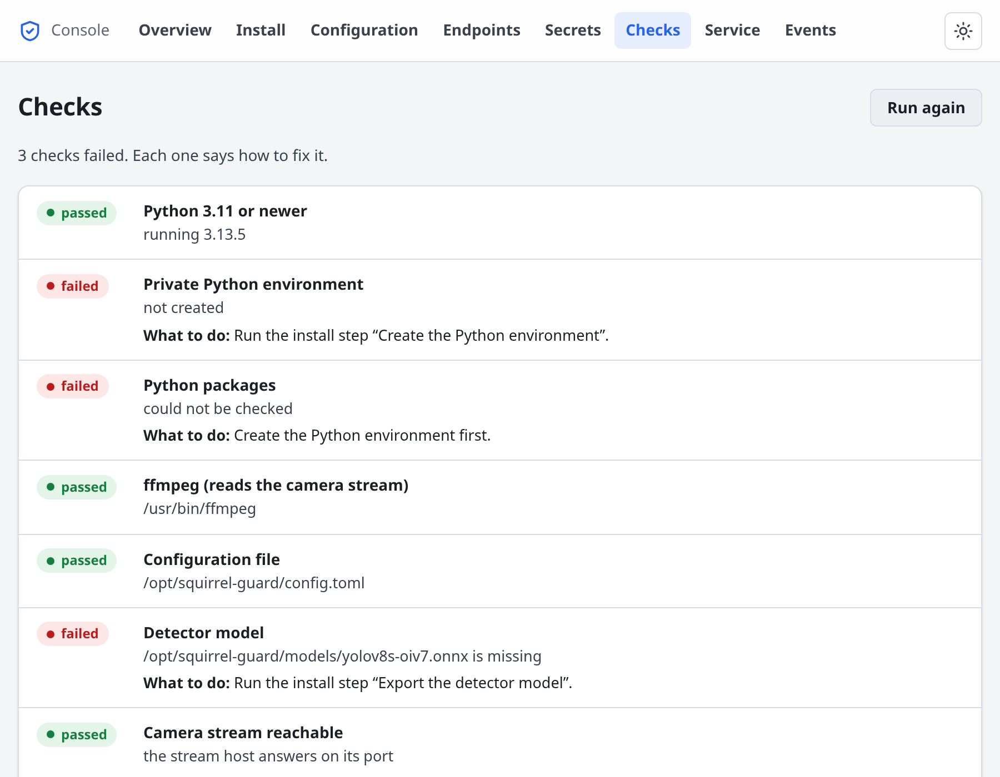
<figcaption>Figure 25. Checks on a machine that is not installed yet. Failures name the install step that fixes them.</figcaption>
</figure>

### 11.7 Terminal menu and keys 

```screen
# title: ./sg  ·  Endpoints page after pressing a (blank rows removed)
 squirrel-guard  ·  Detector workstation
                  │ Second-opinion model (llama.cpp or other OpenAI-compatible server)
   Overview       │ ✓   address  http://127.0.0.1:8080
   Install        │     model    (not set: the server picks)
   Configuration  │     API key  not set
 > Endpoints      │ Message broker (MQTT)
   Secrets        │ ✓   address  192.0.2.10:1883
   Checks         │
   Service        │
   Events         │
                  │─────────────────────────────────────────────────────────────────────────────────────
                  │ Tested: nothing failed.
                  │ Looks at each detection crop and says what it is. Must accept images (llama.cpp:
                  │ --mmproj).  Stored in config.toml (verifier.url).  Last test: answers in 1 ms;
 Enter change   t test   a test all   x remove key   Left back   ? help   q quit
```

| Key | Does |
|---|---|
| <kbd>↑</kbd> <kbd>↓</kbd> or <kbd>j</kbd> <kbd>k</kbd> | move |
| <kbd>Enter</kbd> or <kbd>→</kbd> | open the page, run the step, change the setting |
| <kbd>←</kbd> or <kbd>Esc</kbd> | back to the menu |
| <kbd>1</kbd> to <kbd>8</kbd> | jump to a page |
| <kbd>r</kbd> | refresh |
| <kbd>?</kbd> | help |
| <kbd>q</kbd> | quit |
| <kbd>d</kbd> <kbd>a</kbd> <kbd>o</kbd> | on Install: dry run on or off, run all remaining steps, change the role |
| <kbd>t</kbd> <kbd>a</kbd> <kbd>x</kbd> | on Endpoints: test this server, test all, remove an API key |

Install steps and secret entry leave the full-screen view for the plain terminal, so the output can be scrolled
back and a secret is never drawn on the screen.

### 11.8 Web console restrictions 

The web console can change settings, store secrets and run install steps, so it is restricted:

- **This machine only.** It listens on the loopback address. There is no option to expose it; from another
  computer it is reached through an SSH tunnel.
- **One-time key.** The address it prints carries a random key, valid until the console stops. Requests without
  it are refused.
- **No cross-site requests.** Requests with a foreign host name are refused, and changes also need the key in a
  request header, so another web page cannot drive the console.
- **Fixed steps only.** It runs the listed install steps and nothing else.
- **Secrets go in, never out.** Values are accepted and stored but never sent back to the browser.

---

## 12. Privacy, safety and governance 

What the software refuses to do, how long each kind of data is kept, and what any operator should do before switching identity features on. Figure 26 at the end of this chapter summarises the retention periods and the enforced rules.

### 12.1 What the system will not do

- Name anyone who has not been enrolled by the operator with consent.
- Look up a face, plate or identity in any outside database or service.
- Infer race or ethnicity; there is no such attribute anywhere.
- Use apparent age, gender, expression, face shape, gait or height to decide who someone is.
- Use enhanced or super-resolved images for recognition.
- Act on a person automatically: alerts go to a human, and household or known people never trigger alerts.
- Send video, images, faces or identity data off the local network. The one outside request the evidence features make is a timestamp request, which carries a SHA-256 hash and nothing else ([section 10.5](#105-outside-timestamps-and-clocks)).
- Let a match stand as confirmed without a named person's review ([section 10.3](#103-human-review-of-a-match)).

### 12.2 Retention

| Data | Kept for |
|---|---|
| Continuous recordings | 7 days, or less if the 350 GB cap is reached |
| NVR detection / alert clips | 7 / 14 days |
| Unknown people (sightings, crops, face data) | 90 days |
| Occupants of non-household vehicles (feature off) | 90 days |
| 3D scenes | as long as the sighting (90 days) |
| Enrolled people and their templates | until the person is removed; templates are also deleted when the person's category changes |
| Push-notification cache | 72 hours |
| Evidence packages, custody log, audit log, recording ledger | kept; the tables refuse changes and deletion ([chapter 10](#10-evidence-handling)). A retention period for them is for the operator to set |

### 12.3 Recommendations for any operator

1. Post clear notice that cameras record and that analytics are in use; follow local law on recording public areas, neighbours and audio.
2. Keep identity features (face, unnamed tracking, gait) **off** unless there is a lawful basis and documented consent for every enrolled person.
3. Run new thresholds in shadow mode first, and re-measure accuracy on the installation's own cameras, including at night and with real strangers.
4. Review the licence of every model before deployment; several are non-commercial only (section 14).
5. Keep the access rules: single sign-on, two-factor for administrators, least-privilege groups.
6. Decide who is a viewer, an investigator and a supervisor, publish the evidence signing key's fingerprint, and back up the key, the evidence store and the recording ledger.

<figure class="wide">
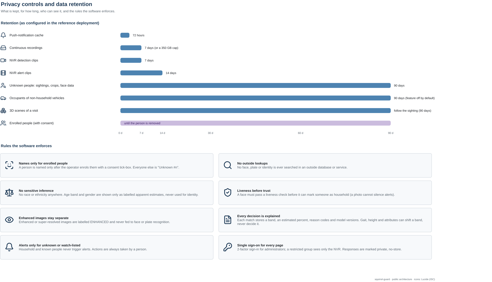
<figcaption>Figure 26. Retention periods and the rules the software enforces.</figcaption>
</figure>

---

## 13. Security architecture 

How the machines are separated, who can reach what, and what is still open. Figure 27 at the end of this chapter shows the machine roles, network zones and permitted connections.

- **Segmentation.** Cameras sit on a separate Wi-Fi segment with no route to the analysis machines. Only the recorder host holds camera credentials; everything else uses the relay.
- **Single sign-on.** Every web interface is behind an nginx TLS proxy and Authelia (default deny; two-factor and passkeys for administrators; a restricted group sees only the NVR). Back ends listen on loopback only. The NVR's authenticated port accepts connections only from the proxy, which adds a shared secret.
- **Least-privilege actuation.** The deterrent key can run one script on the camera; the script validates its input.
- **Message bus and notifications.** MQTT requires a password; the push server denies all access by default and uses tokens.
- **Monitoring.** An inline IPS protects the recorder host; a copy of its traffic is mirrored to a passive IDS whose high-severity alerts are pushed to the operator.
- **Evidence integrity.** Exports are signed and timestamped, logs are hash-chained in tables that refuse changes, and continuous recordings are sealed minutes after capture ([chapter 10](#10-evidence-handling)). <span class="st st-new">New, not deployed</span>
- **Console.** The web console listens on the machine itself only, needs a one-time key, and can run nothing but its fixed install steps ([section 11.8](#118-web-console-restrictions)).
- **Known gaps** (to address before any wider deployment): MQTT runs without TLS on the LAN; some internal hops skip certificate verification on loopback or self-signed links; backups are not defined in the public repository.

<figure class="wide">
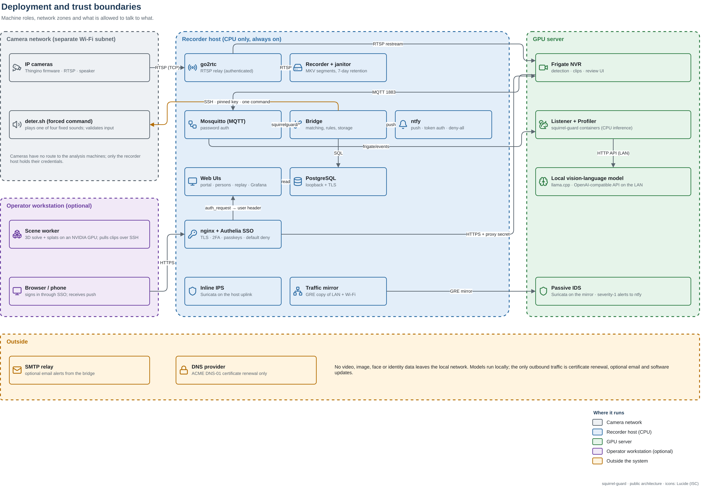
<figcaption>Figure 27. Machine roles, network zones and permitted connections.</figcaption>
</figure>

---

## 14. Third-party models and licences 

Which outside models and software the system uses, what each is used for, and the licence recorded for it. Several of the models that matter most for people analysis are limited to non-commercial use.

> **Notice.** The table records the licence **as stated in the project notes**. It is not legal advice. Weights
> marked *non-commercial* may not be used by a business or, in many cases, a public body. None of the weights are
> included in the public release.

| Component | Used for | Licence (as recorded) |
|---|---|---|
|  Ultralytics YOLOv8 (detect, pose, seg), YOLO-World v2 | detection, pose, silhouettes, objects | AGPL-3.0 (YOLO-World upstream GPL-3.0) |
| OSNet x0.25 | person re-ID | code MIT; weight provenance not recorded |
| OpenGait GaitBase (GREW) | learned gait signature | **academic use only**; no licence file in the source repository |
| Gait measurements (this project) | walk profile and comparison | no model: computed from keypoints |
| InspireFace SDK and model packs | face detection, quality, liveness | **non-commercial** (InsightFace terms); SDK licence not stated |
| AdaFace IR-101 | face embedding | code MIT; weights follow WebFace12M: **non-commercial research** |
|  YuNet; OFIQ | small-face detection and release-copy blurring; face quality | MIT; MIT |
|  MediaPipe Face Landmarker; RTMW | face shape; whole-body keypoints | Apache-2.0 |
| SMPL body model | 3D body | **non-commercial**; outputs never leave the owner's machines |
| PaddleClas PULC | attributes | Apache-2.0, but trained on PA100K and VeRi-776: **non-commercial research** |
| DINOv2 ViT-S/14 | vehicle re-ID | not recorded in the project |
| open-image-models plate detector; fast-plate-ocr | own plate reading, release-copy blurring | code MIT; weight licence not recorded in the project |
| PYSKL ST-GCN++ | action hints | code Apache-2.0; weights trained on NTU RGB+D 120: **non-commercial research** |
| VGGT-1B | 3D scene poses | **CC BY-NC 4.0** (a commercial variant exists, untested) |
| BasicVSR++; drizzle | enhancement | Apache-2.0; BSD-3 |
| TripoSR; Grounding DINO, SAM, Depth Anything V2 Small | 3D objects | MIT; Apache-2.0 |
|  Qwen-family vision-language model, served by  llama.cpp | verification, descriptions | to be confirmed by the operator |
|  Python `cryptography`;  OpenSSL | evidence signatures; checking signatures and timestamps | Apache-2.0 or BSD-3; Apache-2.0 |
|  Frigate,  go2rtc,  Mosquitto,  Authelia,  ntfy,  Grafana,  PostgreSQL,  nginx | platform services | see each project (not restated in the repository) |

Considered and **not used** because of licence or quality: generative face restorers (GFPGAN, CodeFormer), FLAME,
DECA, EMOCA, MICA, SMIRK, PixARMesh for scene objects, and NVIDIA EdgeRunner.

---

## 15. Known limitations and validation gaps 

What has not been shown. Read this chapter before relying on any figure elsewhere in the guide.

- **Small test sets.** Most people-related figures come from one consenting person and stock-clip strangers. There are no confirmed real strangers in the camera test sets. Treat every identity figure as provisional.
- **Night infrared.** Face, attributes, gait and the rig are largely untested at night.
- **Distance.** Faces under about 32 px cannot be used for identity; people under about 40 px are usually missed by the NVR without the sweeper.
- **Calibration assumptions.** Heights and 3D scale depend on calibration; some multi-camera scale still rests on assumed room dimensions.
- **Spoofing.** Face liveness has not been tested against presentation attacks.
- **Acoustic deterrence.** Evidence for effectiveness is weak; animals habituate.
- **Licensing.** Several live components use non-commercial weights; the learned gait weights have no clear licence.
- **New features are untested in the field.** Everything marked <span class="st st-new">New, not deployed</span> has automated tests on test data only: gait measurements on synthetic walkers, plate reading and colour on stock photos, vehicle match bands uncalibrated, evidence packages never made from real recordings, and the console never run through a real installation.
- **Evidence is a technical record.** Hashes, signatures and timestamps show that files and logs are unchanged; they do not show that a camera was truthful, that a match is right, or that a court will accept it.
- **Redaction misses things.** Release copies blur what two detectors find; a person must check every frame.

---

## 16. Appendices 

Terms, credits, sources and the history of this document.

### Appendix A. Glossary

| Term | Meaning |
|---|---|
| AUC | Area under the ROC curve: 1.0 separates same and different perfectly, 0.5 is chance. |
| Band | The plain-language strength of a match: strong, likely, possible, unlikely. |
| Cadence | Steps per minute. |
| Chain of custody | The record of who held or handled a piece of evidence, and when. |
| Ed25519 | A public-key signature scheme. A signature made with the private key can be checked by anyone with the public key. |
| Enrolled | A person the operator added, with a consent record, so the system may name them. |
| Hash (SHA-256) | A short fingerprint of a file. Changing one bit of the file changes the fingerprint. |
| Hash chain | A log in which each entry's hash covers the entry before it, so an edit, removal or reordering breaks every later hash. |
| Liveness | A check that a face is a real face, not a photo held up to the camera. |
| Manifest | The list of every file in an evidence package, with its hash, size and origin. |
| MQTT | A lightweight publish/subscribe message protocol. |
| NVR | Network video recorder (here, Frigate). |
| OpenAI-compatible | A model server that accepts the same requests as OpenAI's chat API, so different servers can be swapped. |
| Re-identification | Recognising that two sightings are the same person or vehicle without knowing who it is. |
| Redaction | Hiding parts of a picture, here by blurring faces and number plates. |
| RFC 3161 timestamp | A signed statement from an outside authority that a given hash existed at a given time. |
| Seal | The hash of a recording segment, written into a hash chain shortly after the segment was recorded. |
| Shadow mode | Running a new model or threshold and logging its decisions without acting on them. |
| SSO | Single sign-on. |
| Splat | Gaussian splatting, a way to render a photographed 3D scene. |
| TAR at FAR | True-accept rate when the false-accept rate is held at a fixed level. |
| TUI | Terminal user interface: a full-screen menu inside a terminal. |

### Appendix B. Image and icon credits

- Figure 3 uses stock photos run through the shipped detector: squirrel and cat from Pixabay (Pixabay Content License); beige sedan by Karthik Vadlamani on Unsplash (Unsplash License).
- Figures 6 and 7 and the bundled replay demo (`deploy/recorder/replay/demo/`: background, cut-out atlas, trajectory) are derived from the stock walking video "hiking, walking, man, alone, nature, forest, fog" by Matthias_Groeneveld on [Pixabay](https://pixabay.com/videos/id-109277/) (Pixabay Content License). The video itself is not redistributed.
- Figures 4 and 8–18 are screenshots of the reference installation, redacted in the page before capture (see the note at the start of chapter 9).
- Figures 5 and 19–25 are screenshots made from test data with invented names and example addresses (`tools/capture_console.py`). Figures 21 and 22 show deliberate tampering by the tests.
- Icons: [Lucide](https://lucide.dev) (ISC licence; copy in `icons/LICENSE-lucide-ISC.txt`).
- Software logos: [Simple Icons](https://simpleicons.org) (CC0-1.0). Each logo is a trademark of its owner and is used only to identify the software; no endorsement is implied. Grey letter tiles are generated by `tools/make_logos.py` for software without a logo there, and are not brand marks.
- Typefaces: Inter and JetBrains Mono, both under the SIL Open Font License 1.1 (copies in `fonts/`), embedded in the PDF.
- Diagrams: generated by `tools/make_diagrams.py`; editable in draw.io.

### Appendix C. Sources

Figures in this guide are quoted from the project's evaluation notes in `docs/` and `README.md`, the deployment
configuration under `deploy/`, and module documentation in `squirrel_guard/`. Internal reference files containing
addresses or account details were deliberately not used.

### Appendix D. Document history

| Version | Date | Changes |
|---|---|---|
| 1.1 | 20 November 2026 | New chapters 10 (evidence handling) and 11 (installation and operation); new sections 6.11 and 7.5; sections 7.2 and 7.3 extended; fifth status label; redesigned layout with page-numbered contents and cross-references; software logos. Chapters 10 to 14 of version 1.0 are now 12 to 16. |
| 1.0 | 19 November 2026 | First public version. |
